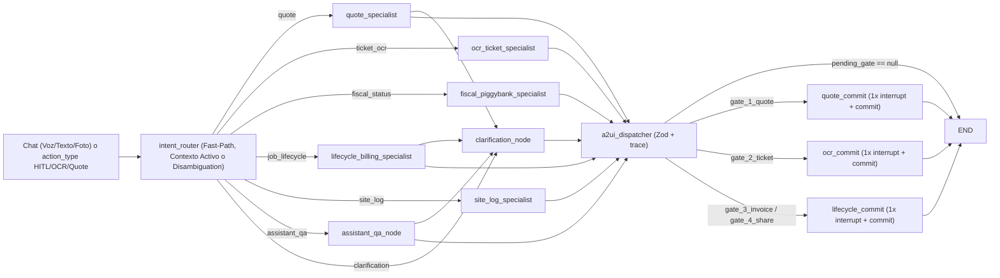

# PRD Agéntico, Gobernanza HITL y Especificación A2UI: ObraLocal AI

## 1. Propósito del Sistema y Declaración del Problema

Los autónomos de oficios técnicos en España (reformas, fontanería, electricidad, albañilería) trabajan a pie de obra sin escritorio ni cobertura estable, lo que provoca tres fricciones diarias:
1. **Presupuestación tardía y con errores:** Redactar presupuestos al final de la jornada genera olvidos de partidas, precios desactualizados y pérdida de trabajos frente a respuestas más rápidas.
2. **Ilusión de caja y extravío de gastos:** Mezclar dinero cobrado con IVA repercutido y pago fraccionado de IRPF distorsiona la liquidez real, mientras que los tickets térmicos de ferretería suelen perderse antes del cierre trimestral.
3. **Dependencia de la nube o gestorías diarias:** Las plataformas SaaS convencionales fallan en sótanos u obras sin conexión, exigen suscripciones y envían datos privados de clientes a servidores externos.

**Objetivo de ObraLocal AI:** Entregar una aplicación móvil nativa (Android/iOS) y ejecutable inmediatamente en navegador Web **100 % Local-First, Offline y Zero-Cloud** (`cloud_cost_eur = 0.00`) que automatiza dictado de presupuestos, lectura OCR de tickets, control de caja fiscal real, ciclo de vida hasta factura y diario fotográfico mediante un único `StateGraph` de LangGraph con **Generative UI (A2UI)** y **supervisión humana obligatoria (HITL)** en toda mutación agéntica de catálogo, contabilidad de gasto, emisión legal o envío externo.

*(Estado del proyecto: repositorio greenfield vacío; este documento define la especificación cerrada del MVP).*

---

## 2. Glosario de Dominio y Conceptos Técnicos

- **Zero-Cloud / Zero-PC:** Toda inferencia, almacenamiento SQLite, búsqueda léxica, OCR, generación de PDF y evaluación se ejecuta en el dispositivo sin red externa, servidor en PC ni claves API (`cloud_cost_eur = 0.00`).
- **A2UI (Generative UI controlada por agente):** Patrón donde el grafo emite opcionalmente (`active_widget: { ui_widget_type, widget_payload } | null`) una tarjeta interactiva perteneciente al catálogo cerrado de 5 widgets de dominio.
- **HITL (Human-in-the-Loop):** Mecanismo nativo de LangGraph JS ([langgraph](https://langchain-ai.github.io/langgraphjs/)) mediante `interrupt()` y `Command(resume)` que congela un hilo en SQLite y exige decisión humana (`approve`, `edit` o `reject`) antes de confirmar acciones agénticas críticas.
- **`thread_id` y `CapacitorSqliteSaver`:** Identificador de sesión conversacional o transaccional persistido junto con sus escrituras pendientes mediante `CapacitorSqliteSaver`, adaptador propio de `BaseCheckpointSaver` sobre SQLite local.
- **Persistencia Híbrida y FTS5:** Capa unificada sobre `@capacitor-community/sqlite` (Android/iOS) y `@sqlite.org/sqlite-wasm` (Web OPFS mono-pestaña) con extensión léxica `FTS5` (ranking BM25 sobre catálogo, clientes y obras) y almacenamiento binario local (`@capacitor/filesystem` / OPFS).
- **Obra directa:** Expediente de obra creado desde el Directorio o el Diario sin presupuesto previo (puede carecer inicialmente de cliente hasta asociar un presupuesto).
- **Aritmética en céntimos enteros:** Toda cifra monetaria se calcula como entero en céntimos de euro con redondeo mitad al alza en TypeScript determinista; ningún modelo de lenguaje calcula importes o impuestos.
- **IVA 10 % vs 21 % (España):** Reforma y reparación de vivienda particular acogida a requisitos legales aplica 10 % (la verificación legal recae en el usuario); locales, comunidades o suministros generales aplican 21 %.
- **Trimestre fiscal (`{YYYY}-T{Q}`):** Trimestres naturales del calendario (`T1`: ene–mar, `T2`: abr–jun, `T3`: jul–sep, `T4`: oct–dic).
- **IVA repercutido vs IVA soportado y Modelo 303:** IVA facturado frente al IVA deducible de tickets. El **Modelo 303** es la autoliquidación trimestral oficial de IVA en España; cada trimestre se calcula de forma aislada sin compensación automática inter-trimestral ni plurianual.
- **IRPF 20 % (Modelo 130 orientativo):** Provisión trimestral del 20 % sobre rendimiento neto positivo (`base facturada - base gastos deducibles`) en estimación directa (AEAT).
- **Anticipo 40 % (`ANT-{YYYY}-XXX`) y Factura Correlativa (`FAC-{YYYY}-XXX`):** Series secuenciales independientes por año fiscal sin huecos ni inversiones cronológicas (pad mínimo de 3 dígitos, ampliable tras `999`); cada obra admite como máximo un anticipo previo fijo del `40 %`, descontado íntegramente en la factura final.
- **AEAT / Verifactu / TicketBAI / SII / Inversión del Sujeto Pasivo:** Normativas oficiales de la Agencia Tributaria española y haciendas forales (excluidas del alcance local del MVP).
- **Contexto conversacional activo (`active_job_id`, `active_quote_id`, `pending_disambiguation`):** Referencias vigentes de obra/presupuesto sincronizadas entre la sesión UI y el hilo LangGraph para encadenar turnos (*"esta obra"*), más estado transitorio para desambiguación dialogada.
- **`assistant_qa_node`:** Nodo conversacional de solo lectura que responde preguntas factuales breves en texto consultando únicamente SQLite local (`active_widget = null`).
- **Adaptadores desacoplados (`LocalInferenceAdapter`, `VoiceInputAdapter`):** Contratos para inferencia local (motor determinista `<150 ms` por defecto + conector opcional MediaPipe GenAI tras importación local) y reconocimiento de voz on-device estricto.

---

## 3. Alcance Cerrado del MVP (In-Scope vs Out-of-Scope)

| Dimensión | In-Scope (MVP Cerrado) | Out-of-Scope (Excluido Explícitamente) |
| :--- | :--- | :--- |
| **Plataforma y Red** | 100 % offline en Capacitor (Android/iOS) y arranque Web inmediato (`Vite` + Service Worker PWA únicamente en compilaciones Web) sin registro, login ni red externa. | Sincronización cloud, APIs LLM externas, servidores en PC local, Python en runtime. |
| **Modularidad y Carga** | Organización modular limpia (núcleo transversal, orquestador LangGraph y carpetas verticales por dominio) con carga diferida bajo demanda de OCR WASM, generador PDF offline y Suite de Evals `:memory:`. | Bundle monolítico con carga inicial obligatoria de motores WASM/PDF o datasets de test en el primer renderizado. |
| **Orquestación** | Único `StateGraph` (`@langchain/langgraph/web`) con contexto multi-turno, `assistant_qa_node` sobre SQLite real, OCR, desambiguación dialogada voz/texto y 4 puertas HITL; vistas CRUD directas sobre servicios compartidos. | Colas distribuidas externas, llamadas LLM fuera del grafo, cifras conversacionales inventadas fuera de SQLite, bucles automáticos tras `reject`. |
| **Inferencia Local** | Motor determinista/heurístico (`<150 ms`) tras `LocalInferenceAdapter` + conector opcional MediaPipe GenAI (`@capgo/capacitor-llm` nativo / `@mediapipe/tasks-genai` WebGPU) activable solo tras importar paquete local compatible en hardware apto (con botón para liberar de memoria). | `llama.rn` (exclusivo React Native JSI), descarga de pesos por internet, selector LLM activo sin archivo cargado. |
| **Hardware y Archivos** | Voz estrictamente on-device mediante `@capgo/capacitor-speech-recognition` tras `VoiceInputAdapter` (verificando paquete offline en móvil; oculto en Web o dispositivos sin reconocimiento offline), cámara/galería (`@capacitor/camera`), archivos locales, OCR (`tesseract.js` WASM local), PDF (`pdfmake` offline). | Streaming de voz a servidores de Google/Apple/navegador, carga de idiomas o workers desde CDN. |
| **Fiscalidad y Respaldo** | Cálculo determinista IVA 10 %/21 %, IRPF 20 %, anticipo 40 %, hucha fiscal trimestral, PDF offline regenerable bajo demanda, envío vía `@capacitor/share` / `navigator.share` / `wa.me` tras Gate 4, directorio CRUD completo (Obras, Clientes, Catálogo, Tickets de Gastos y Diario), **exportación/importación simétrica local JSON** (con cifrado opcional WebCrypto AES-GCM) y contadores iniciales tras reinicio de fábrica. | Presentación telemática AEAT, firma Verifactu/SII/TicketBAI, facturas rectificativas, retenciones IRPF en factura (`-15 %`/`-7 %`), inversión del sujeto pasivo, múltiples anticipos fraccionados, arrastre inter-trimestral de IVA o cifrado SQLCipher nativo. |
| **Ajustes y Auditoría** | Panel de **Ajustes y Auditoría** con: Respaldo JSON, *"Restaurar Datos Demo"*, *"Empezar de cero"*, importación opcional de LLM, Inspector (`agent_traces` con `cloud_cost_eur = 0.00` y `feedback_corrections` del catálogo) y Suite de Evals `:memory:` (complementando `Vitest` y Playwright en PC). | Telemetría remota, analítica SaaS o reentrenamiento neuronal en móvil. |

*(Regla anti-botones muertos: cada control visible en UI corresponde a un flujo conectado al grafo o servicios locales; los botones dependientes de hardware offline no disponible permanecen ocultos).*

---

## 4. Arquitectura de Capas, Topología del Grafo y Estado

### Capas Modulares y Coherencia UI ↔ Grafo
1. **Arquitectura en Capas y Carpetas Verticales:**
   - **Núcleo Compartido:** Repositorios y transacciones SQLite (`FTS5`), almacenamiento binario local, motor fiscal en céntimos, validadores de esquema, servicio común de trazabilidad (`agent_traces`), `LocalInferenceAdapter`, `VoiceInputAdapter`, servicio multimedia (compresión/pre-procesado y estampado) y los 5 componentes React A2UI reutilizables.
   - **Capa de Orquestación Agéntica:** `StateGraph`, `CapacitorSqliteSaver`, enrutador, especialistas, `assistant_qa_node`, `clarification_node`, `a2ui_dispatcher` y 3 nodos lineales HITL (`quote_commit`, `ocr_commit`, `lifecycle_commit`).
   - **Carpetas Verticales por Dominio (`quotes`, `ocr-tickets`, `fiscal`, `billing`, `site-log`, `directory`, `inspector`):** Encapsulan casos de uso y carga diferida de OCR WASM y generador PDF consumiendo únicamente el núcleo y orquestación sin importaciones circulares.
2. **Vistas Directas de UI y Flujos Conversacionales:**
   - **Pestaña Directorio (*Obras, Clientes, Catálogo y Gastos*):** CRUD de **Clientes** (bloquea borrado si está referenciado), CRUD de **Catálogo**, vista/edición/borrado de **Tickets archivados** (incluidos `"Gasto general"`) e historial/fotos del **Diario**, creación de obra directa, apertura de obra en `JobLifecycleActionWidget`, añadir o reeditar presupuesto `borrador` (`start_job_quote`), marcar factura `pagado` (fecha editable, hoy por defecto, o revertible a `pendiente_cobro`), marcar presupuesto `aceptado`/`rechazado`, marcar manualmente `quote` o `invoice` como enviado (`sent_at`, promoviendo `borrador → enviado` y conservando `aceptado`), avanzar `job_status` y regenerar/abrir PDFs bajo demanda.
   - **Pestaña Hucha Fiscal:** Consulta directa por trimestre `{YYYY}-T{Q}` del `FiscalPiggyBankWidget`.
   - **Barra Inferior de Acción Rápida:** **Micrófono** (visible solo en móvil con reconocimiento offline verificado; ante fallo de permiso muestra recuperación inline), **Nuevo Chat** (abre nueva sesión multi-turno sin cancelar pausas previas), **Nuevo Presupuesto** (abre nueva sesión de Chat enfocada en el compositor con acceso rápido `start_empty_quote`), **Escanear Ticket** (abre cámara/galería —o `manual_ticket_entry` si falta permiso— e inicia nuevo hilo vía `scan_ticket` incluso con otro hilo pausado) y **Foto Diario** (abre `SiteLogStampWidget` directamente mediante el núcleo sin entrar al grafo).
   - **Puente limpio para Gates 3 y 4:** Pulsados desde `JobLifecycleActionWidget` dentro de un hilo de Chat, continúan en ese mismo `thread_id`. Pulsados desde el Directorio, abren un `thread_id` transaccional limpio en Chat Agéntico mostrando el Gate 3 o 4; cualquier edición previa en Directorio se valida en vivo en `*_commit` antes de confirmar.

### Contratos de Estado, Contexto Multi-Turno y `interrupt()` Lineal
- **Estado lógico del grafo (`StateGraph`):** Historial multi-turno de mensajes, contexto activo sincronizable (`active_job_id`, `active_quote_id`), desambiguación transitoria (`pending_disambiguation` con intención original, candidatos y `raw_media_uri` pendiente), entrada (`text`, `action_type`, referencias objetivo `job_id`/`quote_id`/`invoice_id`, `billing_sub_intent`, `raw_media_uri`), entidades extraídas, fragmentos `FTS5`, `active_widget` nulable, `quick_actions` opcional, `pending_gate`, `human_decision` y métricas de traza.
- **Sincronización bidireccional de contexto (`active_job_id` / `active_quote_id`):** La interfaz mantiene un contexto de sesión activo que se pasa como entrada en cada invocación del grafo y se actualiza con la salida del grafo (cuando un turno crea, confirma o consulta una obra/presupuesto). Si `SiteLogStampWidget` o una selección manual del usuario cambia la obra activa en sesión, la siguiente invocación de Chat recibe ese `active_job_id` actualizado (limpiando `active_quote_id` si no coincide) para que *"esta obra"* resuelva siempre sin desincronización ni mutar checkpoints antiguos.
- **Trazabilidad uniforme:**
  - `a2ui_dispatcher` valida el estado de salida mediante el servicio común de esquema y trazas (`cloud_cost_eur = 0.00`) antes de `END` o `*_commit` (ante fallo interno limpia `active_widget`, `pending_gate` y `human_decision`, emitiendo error tipado).
  - Los widgets validan campos en cliente antes de `Command(resume)` (`approve` si no hubo cambios frente a la propuesta, o `edit` con `editedPayload` si hubo modificaciones). Así, `*_commit` invoca `interrupt()` **una única vez de forma lineal**, verifica vigencia en vivo SQLite (si la obra fue cancelada o ya facturada desde Directorio, aborta limpiando `pending_gate = null`, `human_decision = null`, `active_widget = null` e informa el conflicto), ejecuta o cancela, resetea `pending_gate = null` y `human_decision = null`, registra la traza y termina en `END`.

### Nodos Activos del Grafo
1. **`intent_router`:** Si recibe `action_type` explícito (`scan_ticket`, `manual_ticket_entry`, `start_empty_quote`, `start_job_quote`, `request_invoice_gate`, `request_advance_gate`, `request_share_gate`, `resolve_disambiguation`), enruta directamente (`resolve_disambiguation` selecciona candidato o clasifica `raw_media_uri` pendiente hacia `ticket_ocr` o `site_log`). Para mensajes libres invoca `LocalInferenceAdapter`:
   - *Resolución prioritaria de `pending_disambiguation`:* Evalúa si la respuesta de voz o texto selecciona un candidato o aclara una imagen pendiente; si dice *"cancelar"*, cambia de tema o pulsa una acción rápida de barra inferior, limpia `pending_disambiguation` y enruta normalmente.
   - *Motor determinista (<150 ms, por defecto):* normaliza español, distingue consultas factuales (`assistant_qa`) frente a tarjetas visuales (`fiscal_status`) u otros flujos, segmenta partidas, extrae cantidades y unidades, deduce IVA (`10 %` vivienda vs `21 %` defecto), detecta `billing_sub_intent` (`advance_40` | `final_invoice` | `share` | `overview`), hereda `active_job_id`/`active_quote_id` y clasifica imágenes adjuntas. Ante falta de indicios o empate, deriva a `clarification_node`.
   - *Conector opcional MediaPipe GenAI:* Desactivado por defecto sin pesos en el bundle. Solo tras importar un archivo `.task`/`.litertlm` de instrucción compatible en hardware apto (móvil nativo compatible o navegador WebGPU), refina entradas ambiguas que caerían a `clarification_node` bajo esquema Zod estricto, cayendo al motor determinista ante fallo y permitiendo descarga de memoria.
2. **`quote_specialist`:** Consulta `FTS5` (o abre `QuoteBuilderWidget` vacío ante `start_empty_quote`; si recibe `start_job_quote` carga el `borrador` a editar o vincula a obra directa). Si `active_job_id` apunta a obra directa sin presupuesto o rechazado, vincula a ella; si ya tiene presupuesto activo no rechazado y el usuario aludió a *"esta obra"*, deriva a `clarification_node` (`pending_gate = null`, ofreciendo editar el `borrador` o crear obra anexa); en caso válido fija `pending_gate = "gate_1_quote"`.
3. **`ocr_ticket_specialist`:** Si hay `raw_media_uri`, carga bajo demanda el adaptador OCR local tras pre-procesado; si llega dictado textual sin foto o `manual_ticket_entry`, aplica extracción determinista de texto; sugiere obra compatible y fija `pending_gate = "gate_2_ticket"` con `TicketOcrValidatorWidget` (ante error del motor OCR graba error y abre el widget en Gate 2 para carga manual).
4. **`fiscal_piggybank_specialist`:** Calcula `{YYYY}-T{Q}` y emite `FiscalPiggyBankWidget` (`pending_gate = null`).
5. **`lifecycle_billing_specialist`:** Resuelve obra/documento; si hay 0 o varias coincidencias en Chat deriva a `clarification_node` (`pending_gate = null`, `pending_disambiguation` con acciones rápidas). Si intenta Gate 3 sin presupuesto elegible devuelve resumen (`pending_gate = null`). En caso válido, emite `JobLifecycleActionWidget` en vista resumen, Gate 3 (`advance_40` o `final_invoice`) o Gate 4.
6. **`site_log_specialist`:** Resuelve obra vía `FTS5` o `active_job_id`, y emite directamente `SiteLogStampWidget` (`pending_gate = null`, precargando la obra resuelta o dejando el selector/creación exprés visible ante 0 o múltiples coincidencias sin vuelta previa a `clarification_node`) para confirmar el estampado y guardado en SQLite mediante `core`.
7. **`assistant_qa_node`:** Consulta únicamente datos reales de SQLite (facturas, catálogo, tickets, presupuestos, obras). Ante múltiples obras coincidentes deriva a `clarification_node` (`pending_gate = null`); si no hay datos lo declara explícitamente; si resuelve obra concreta actualiza contexto y responde en texto (`active_widget = null`, `pending_gate = null`).
8. **`clarification_node`:** Emite pregunta conversacional breve en texto para respuesta dialogada por voz o texto en el mismo `thread_id`, fijando `pending_disambiguation`, `active_widget = null`, `pending_gate = null` y `quick_actions` táctiles (`resolve_disambiguation` o accesos directos de acción).
9. **`quote_commit`, `ocr_commit`, `lifecycle_commit`:** Nodos HITL lineales con carga diferida del generador PDF, verificación SQLite en vivo y reseteo de `pending_gate` y `human_decision`.

---

## 5. Modelo de Dominio y Reglas Fiscales Deterministas

### Entidades, Campos Clave e Invariantes
1. **`client`:** Identificador, `nombre/razón social` (único campo obligatorio en alta rápida), NIF/CIF, dirección fiscal, teléfono, email. Borrado bloqueado si tiene obra, presupuesto o factura vinculados.
2. **`job` (Obra, `OBR-{YYYY}-XXX`):** Identificador, `client_id` (opcional en obra directa), título/dirección, fecha de creación y estado físico inicial `pendiente` (`job_status`: `pendiente` | `en_curso` | `finalizado` | `cancelado`).
   - *Transiciones:* `pendiente → en_curso | cancelado`; `en_curso → finalizado | cancelado`.
   - *Invariante:* **Prohibido cancelar si tiene emitida alguna factura (`ANT` o `FAC`).** Al cancelar una obra sin facturas, su presupuesto activo no rechazado pasa automáticamente a `rechazado`. Una obra `finalizado` sin factura puede presupuestarse y facturarse; al confirmar Gate 1 sobre una obra directa sin cliente se vincula automáticamente ese cliente.
3. **`quote` (Presupuesto, `PRE-{YYYY}-XXX`):** Vinculado a `job_id`, instantánea de datos del cliente, líneas (cantidad positiva entera/decimal, unidad, descripción, precio unitario en céntimos), IVA (`10 %` | `21 %`), referencia PDF, marca de envío y `quote_status`: `borrador` | `enviado` | `aceptado` | `rechazado`.
   - *Transiciones válidas:* `borrador → enviado | aceptado | rechazado`; `enviado → aceptado | rechazado`; `aceptado → rechazado` (únicamente si no existen facturas `ANT`/`FAC`).
   - *Invariantes:* Máximo un presupuesto activo por obra; en `borrador` puede reeditarse en `QuoteBuilderWidget` sobrescribiendo el mismo `PRE-{YYYY}-XXX` y regenerando su PDF (sin registrar correcciones de catálogo salvo si se activa explícitamente el toggle en Gate 1); tras pasar a `enviado` o `aceptado` sus líneas quedan fijas para corresponder con el documento enviado (solo admite pasar a `rechazado` para crear sustituto). Emitir `ANT` o `FAC` promueve automáticamente a `aceptado` y bloquea el rechazo posterior. Marcar manualmente `sent_at` en Directorio sobre un `borrador` lo promueve a `enviado`.
4. **`invoice` (Anticipo 40 % `ANT-{YYYY}-XXX` o Factura `FAC-{YYYY}-XXX`):** Registro inmutable tras Gate 3 vinculado a obra y presupuesto, con **instantánea inmutable del cliente en la fecha de emisión**, fecha de emisión (`>= última factura de la misma serie`, hoy por defecto editable en Gate 3), fecha de vencimiento (`+30 días` por defecto, editable), trimestre `{YYYY}-T{Q}`, fecha de cobro opcional, marca de envío opcional, base neta, IVA neto, total neto, base del anticipo descontado y referencia PDF.
   - `invoice_status`: `pendiente_cobro` → `pagado` | `vencido`; `vencido` → `pagado` (vencimiento evaluado al leer/arrancar; corrección manual permitida desde Directorio).
   - **Anticipo único:** Máximo 1 `ANT` del `40 %` por obra, descontado íntegramente al emitir `FAC` (bloqueado `ANT` si ya existe `FAC`).
5. **`expense_ticket`:** Ticket pagado al contado/tarjeta con `job_id` nulable (`null` = `"Gasto general"`), fecha, trimestre `{YYYY}-T{Q}`, proveedor (`"Proveedor sin identificar"` por defecto si ilegible), NIF nulable, base, IVA, total en céntimos, confianza OCR (`0..100`) e `image_uri` nulable.
6. **`site_log`:** Entrada vinculada a `job_id` con nota, `photo_uri` sellada y comprimida (opcional), categoría (`antes` | `despues` | `nota`) y timestamp. El sello estampa fecha, hora, `OBR-{YYYY}-XXX` y cliente (o `"Sin cliente asignado"`).
7. **`catalog_items` y `feedback_corrections`:** Tarifario editable de partidas (descripción, precio unitario en céntimos, unidad, categoría `Fontanería | Electricidad | Albañilería | Pintura | General`) y registro histórico append-only de ajustes confirmados desde Gate 1 (`item_id`, precio anterior —`0` en altas nuevas de catálogo—, precio nuevo, fecha).
8. **`agent_traces` y series locales:** Trazas (`cloud_cost_eur = 0.00`, códigos tipados de error) y configuración de último número ya emitido de `FAC`, `ANT`, `OBR` y `PRE` para el año `{YYYY}` en curso (solo configurable con valor `>= máximo emitido en el año`, reiniciándose a `001` al cambiar de año fiscal).

### Fórmulas Deterministas de la Hucha Fiscal (`{YYYY}-T{Q}`)
- **Redondeo y reconciliación:** Cada línea redondea mitad al alza su subtotal; `iva_total_presupuesto = round_half_up(sum(subtotales) * tasa_iva)`. El anticipo 40 % aplica `base_ANT = round_half_up(base_presupuesto * 0.40)` e `iva_ANT = round_half_up(base_ANT * tasa_iva)`. `FAC` liquida exactamente la diferencia (`base_presupuesto - base_ANT` e `iva_total_presupuesto - iva_ANT`).
1. **IVA Repercutido Trimestre (`issued_at` en `{YYYY}-T{Q}`):** Suma del IVA de `ANT` y `FAC` emitidas en el trimestre.
2. **IVA Soportado Deducible (`{YYYY}-T{Q}`):** Suma del IVA de `expense_tickets` del trimestre.
3. **IVA Neto a Reservar (trimestre aislado):** `max(0, iva_repercutido - iva_soportado)` (si la diferencia `iva_repercutido - iva_soportado` es negativa, reserva `0 €` y muestra `"X € IVA a compensar"`).
4. **Reserva IRPF 20 % (Modelo 130 orientativo):** `rendimiento_neto = max(0, base_emitida_ANT_y_FAC_trimestre - base_tickets_trimestre)`; `irpf_reserva = round_half_up(rendimiento_neto * 0.20)`.
5. **Dinero Intocable para Hacienda (Devengo `{YYYY}-T{Q}`):** `iva_neto + irpf_reserva`.
6. **Coherencia Caja vs Devengo en `{YYYY}-T{Q}` (importes con IVA `total_cents`):**
   - `cobrado_mismo_trimestre`: suma de `total_cents` de facturas emitidas **en `{YYYY}-T{Q}`** cuya `fecha de cobro` también cae en `{YYYY}-T{Q}` y están en estado `pagado`.
   - `cobros_trimestres_anteriores`: indicador separado de facturas emitidas en trimestres previos cuya `fecha de cobro` cae en `{YYYY}-T{Q}` (sus impuestos ya devengaron en su trimestre de emisión).
   - `pendiente_cobro_trimestre`: suma actual de `total_cents` de facturas `pendiente_cobro`/`vencido` emitidas en `{YYYY}-T{Q}` (más aviso separado si existen facturas `pendiente_cobro`/`vencido` de trimestres previos).
7. **Saldo Disponible Real (`{YYYY}-T{Q}`):** `(cobrado_mismo_trimestre - total_tickets_trimestre) - dinero_intocable_hacienda`, siendo `total_tickets_trimestre` la suma total con IVA de `expense_tickets` en `{YYYY}-T{Q}` (alerta visual si es `< 0` por facturas emitidas aún pendientes de cobro frente a impuestos devengados, mostrando aparte `cobros_trimestres_anteriores`).
8. **Beneficio Neto por Obra (acumulado histórico):** `base_emitida_ANT_y_FAC_obra - base_tickets_vinculados_obra` para obras activas (`pendiente` o `en_curso`) y obras no canceladas con facturas o tickets en `{YYYY}-T{Q}`.

---

## 6. Alternativas Arquitectónicas Evaluadas (Evaluación de Trade-Offs)

1. **LangGraph `StateGraph` + `CapacitorSqliteSaver` vs FSM Ligera vs ReAct Único:**
   - *Rechazado ReAct Único:* Modelos pequeños fallan eligiendo herramientas y multiplican latencia.
   - *Trade-off FSM Ligera:* Una FSM evitaría `BaseCheckpointSaver`, la serialización de checkpoints y su limpieza ante cambios de esquema, pero obligaría a reimplementar persistencia de pausas HITL, sesiones multi-turno y trazas estándar. *Elegido:* Flujos conversacionales, OCR, QA y 4 Gates HITL en `StateGraph`, con lectura/CRUD directo sobre servicios compartidos.
2. **Motor Determinista + `LocalInferenceAdapter` vs `llama.rn`, `VoiceInputAdapter` y Comandos por Chips:**
   - *Rechazado `llama.rn`:* Exclusivo de React Native JSI; incompatible con Capacitor.
   - *Conector opcional MediaPipe vs Determinista puro y Comandos por Chips:* Frente a obligar al usuario a navegar solo por menús/chips o acoplar pesos pesados en arranque, `LocalInferenceAdapter` ejecuta el MVP con el motor determinista (`<150 ms`) complementado con `clarification_node` (botones rápidos) y deja MediaPipe desacoplado e inactivo salvo importación local en dispositivo apto.
   - *`@capgo/capacitor-speech-recognition` vs `@capacitor-community/speech-recognition` / Whisper WASM:* Se elige `@capgo/capacitor-speech-recognition` por ofrecer verificación explícita offline on-device, descartando Whisper WASM por peso/latencia en móvil frente a ocultar el micrófono en Web.
3. **OCR Offline `tesseract.js` WASM vs ML Kit / Apple Vision Nativo:**
   - *Trade-off:* Los motores nativos consumen menos RAM, pero exigen dos puentes nativos distintos y carecen de ejecución en Web. *Elegido:* `tesseract.js` WASM con carga diferida, pre-escalado en canvas y revisión en Gate 2.
4. **SQLite Dual con `FTS5` vs `jeep-sqlite` / `wa-sqlite` / IndexedDB / `SQL LIKE`:**
   - *Rechazado `jeep-sqlite` (omite `FTS5`), `wa-sqlite` + snapshots IndexedDB (fragilidad y borrado en incógnito) y `SQL LIKE` (sin ranking BM25).* *Elegido:* `@sqlite.org/sqlite-wasm` con OPFS mono-pestaña y alerta bloqueante si está restringido.
5. **Modularidad Pragmática + Lazy-Loading + `assistant_qa_node` vs Monolito Eager + Solo Widgets:**
   - Separar núcleo, agente y carpetas verticales permite carga diferida de OCR WASM/PDF (precacheados solo en Web PWA) sin bus complejo. `assistant_qa_node` evita renderizar widgets completos ante preguntas factuales rápidas.
6. **PDF `pdfmake` bajo Demanda + Respaldo JSON Cifrado vs `window.print` + Snapshot `.sqlite`/ZIP:**
   - *Rechazado `window.print` (sin binario adjuntable) y snapshots `.sqlite`/ZIP (frágiles entre versiones y pesados con fotos).* *Elegido:* `pdfmake` pre-validado en memoria en Gate 1/3 y regenerable bajo demanda desde instantáneas (evitando regeneración masiva en importación), más Exportar/Importar JSON simétrico de datos de dominio/contadores con **cifrado opcional WebCrypto AES-GCM** (evaluado frente a hacerlo obligatorio para permitir inspeccionar JSON si el usuario acepta explícitamente el aviso PII).
7. **Share Web (`navigator.share` en vista confirmada), Estampado vs Overlay, Demo Boot y Evals On-Device:**
   - Separar la confirmación HITL de Gate 4 del disparo de `navigator.share({ files })` en el gesto de botón sobre el widget confirmado evita errores de activación de usuario en Web y bucles post-interrupción. El estampado sobre copia comprimida conserva evidencia autoverificable al compartir fuera de la app. Precargar datos demo en primer arranque (vía fixtures directos sin WASM OCR, con opción *"Empezar de cero"*) permite probar Gate 1/2 en cero pasos frente a arrancar vacío con carga manual. La batería `:memory:` en la vista Inspector permite auditar en el dispositivo real `FTS5`, aritmética fiscal y Zod junto a `Vitest`/Playwright en PC.

---

## 7. Capacidades Locales del Sistema y Nivel de Riesgo

| Capacidad Local | Riesgo | Capa / Nodo | Comportamiento |
| :--- | :--- | :--- | :--- |
| `search_catalog_fts5` / `search_clients_fts5` / `search_jobs_fts5` | Bajo (Automática) | Núcleo, Especialistas, Directorio | Búsqueda BM25 sanitizada en `FTS5`. |
| `query_sqlite_assistant_facts` | Bajo (Automática) | `assistant_qa_node` | Lee exclusivamente facturas, catálogo, tickets, presupuestos y obras para responder en texto. |
| `compute_fiscal_totals` / `read_fiscal_piggybank` | Bajo (Automática) | Núcleo fiscal, Especialistas, Directorio | Cálculos deterministas en céntimos enteros. |
| `run_offline_ocr` | Bajo (Automática) | `ocr_ticket_specialist` | Carga diferida de OCR WASM, pre-escalado/contraste desde URI o extracción determinista de dictado. |
| `stamp_and_save_site_log` | Bajo (Automática) | Núcleo + `SiteLogStampWidget` | Estampa sello tras confirmación explícita, comprime imagen local, guarda `site_logs` y sincroniza contexto de sesión UI. |
| `manage_directory_records` | Bajo (Automática) | Directorio | CRUD clientes/catálogo/tickets/diario sujeto exactamente a los mismos validadores Zod/fiscales de `core` (`± 2 céntimos`, bloqueos de borrado), obra directa, cobro (`pagado` reversible), `job_status`, rechazo/aceptación, envío manual (`sent_at` promoviendo `borrador → enviado`) y regeneración PDF. |
| `commit_quote_and_pdf` | **Alto — Gate 1** | `quote_commit` | Pre-genera PDF en memoria, guarda presupuesto/obra (asignando cliente si faltaba), actualiza catálogo confirmado y persiste PDF. |
| `archive_expense_ticket` | **Alto — Gate 2** | `ocr_commit` | Inserta ticket validado en `expense_tickets` vinculado a obra o `"Gasto general"`. |
| `issue_correlative_invoice` | **Alto — Gate 3** | `lifecycle_commit` | Pre-genera PDF en memoria, asigna correlativo atómico `FAC`/`ANT` con instantánea de cliente, fija fechas, descuenta 40 % y guarda PDF. |
| `dispatch_external_share` | **Alto — Gate 4** | `lifecycle_commit` + UI Gate 4 | Prepara envío aprobado en Gate 4 y dispara `@capacitor/share` / `navigator.share` / descarga+`wa.me`, registrando `sent_at` al confirmarse. |

---

## 8. Puntos de Control Human-in-the-Loop (HITL Gates) y Flujos de Hilo

### Reglas de Hilo, Concurrencia y Validación Pre-Resume
- La sesión de Chat mantiene un `thread_id` multi-turno activo (el usuario puede pulsar **Nuevo Chat** o cambiar en historial). Gates 3/4 desde Chat continúan en el hilo activo; desde Directorio abren un hilo limpio en Chat.
- Mientras el hilo mostrado esté en `interrupted`, el compositor libre y **Micrófono** quedan bloqueados (permitiendo motivo de rechazo opcional inline en la tarjeta, guardado en historial y trazas), mientras siguen operativos **Nuevo Chat**, **Nuevo Presupuesto**, **Escanear Ticket** y **Foto Diario**.
- Todas las validaciones (incluyendo detección en vivo de posibles tickets duplicados en Gate 2) se ejecutan en cliente antes de `Command(resume)`: si el usuario no alteró los campos propuestos se envía `approve`, y si editó algún valor se envía `edit` con `editedPayload`; `*_commit` ejecuta `interrupt()` **una única vez de forma lineal** y valida SQLite en vivo antes de escribir.

### Detalle de los 4 Gates
1. **Gate 1 — Confirmación de Presupuesto, Tarifa y PDF (`gate_1_quote`):**
   - *Disparador:* Dictado en Chat (`quote_specialist`), `start_empty_quote` o `start_job_quote` (nuevo o reedición de `borrador`).
   - *Comportamiento:* Exige ≥ 1 línea (`precio > 0 €`), título de obra y cliente con nombre. Verifica antes de escribir que la obra siga vigente (no cancelada ni con otro presupuesto activo distinto). Actualiza `catalog_items` y `feedback_corrections` únicamente en líneas con toggle de catálogo activo (por defecto activo en altas nuevas de ítems no catalogados, desactivado en ajustes puntuales de ítems existentes o reedición de `borrador`). Pre-genera PDF en memoria, guarda o actualiza in-place el presupuesto (`borrador` existente si se reeditaba) + obra, actualiza contexto activo y devuelve `JobLifecycleActionWidget`. En `reject`, cancela sin persistir (`active_widget = null`).
2. **Gate 2 — Validación y Archivo de Ticket OCR (`gate_2_ticket`):**
   - *Disparador:* `scan_ticket`, `manual_ticket_entry` o dictado/foto clasificado como `ticket_ocr`.
   - *Comportamiento:* Exige `fecha`, `base`, `iva` (`>= 0`) y `total` dentro de tolerancia de redondeo (`|(base + iva) - total| <= 2 céntimos`), admitiendo proveedor por defecto (`"Proveedor sin identificar"`) y NIF vacío en tickets simplificados, y edición combinada en multi-IVA. Comprueba duplicados en vivo contra `expense_tickets` (`(nif, fecha, total)` con NIF real o `(fecha, total)` sin NIF) advirtiendo antes de enviar `Command(resume)`. Archiva y limpia `active_widget = null`. En `reject`, limpia imagen temporal pre-OCR y descarta (`active_widget = null`).
3. **Gate 3 — Emisión de Factura Correlativa o Anticipo 40 % (`gate_3_invoice`):**
   - *Disparador:* `request_advance_gate`, `request_invoice_gate` o solicitud en Chat (`billing_sub_intent` explícito) sobre presupuesto no rechazado; muestra confirmación legal con correlativo provisional, cliente, fecha emisión (`>= última factura de la serie`, editable), vencimiento (`+30 días` por defecto), descuento 40 % previo e importes netos.
   - *Comportamiento:* Bloquea doble anticipo, anticipo tras `FAC` o doble `FAC`, y exige NIF + dirección fiscal (actualizando cliente maestro solo tras confirmar emisión). Pre-genera PDF en memoria, asigna correlativo atómico, guarda instantánea del cliente, promueve presupuesto a `aceptado`, guarda PDF y devuelve `JobLifecycleActionWidget` en vista resumen. En `reject`, aborta sin consumir correlativo ni alterar al cliente (`active_widget = null`).
4. **Gate 4 — Envío Externo al Cliente (`gate_4_share`):**
   - *Disparador:* `request_share_gate` o solicitud en Chat sobre presupuesto no rechazado o factura; muestra destinatario, documento objetivo, PDF local y mensaje plantilla editable.
   - *Comportamiento:* Al aprobar (`approve` o `edit` si cambió teléfono/mensaje), `lifecycle_commit` valida el teléfono (solo dígitos/E.164 si se indicó), actualiza el teléfono del cliente si se editó, pre-verifica el PDF y finaliza el turno dejando `JobLifecycleActionWidget` en modo listo para compartir (`pending_gate = null`):
     - En **Capacitor nativo**, lanza inmediatamente `@capacitor/share` con el PDF adjunto; si completa sin cancelación, marca `sent_at` (`borrador → enviado`, preservando `aceptado`) y cierra; si se cancela la hoja nativa, permite reintentar o marcar manualmente vía servicio de dominio.
     - En **Web**, el botón **"Abrir Compartir / WhatsApp"** ejecuta `navigator.share({ files })` dentro del gesto de clic del usuario (o descarga el PDF + abre enlace `wa.me` validado si hay teléfono, o solo descarga si falta teléfono) y habilita confirmación manual 1-toque de envío vía dominio sin reescribir checkpoints.
     - En `reject`, cancela sin cambios (`active_widget = null`).

---

## 9. Catálogo Cerrado de los 5 Widgets A2UI y Casos Borde

Interfaz a una mano con 3 áreas (**Chat Agéntico** | **Directorio** | **Hucha Fiscal**), barra inferior rápida y cabecera con historial de hilos y panel de **Ajustes y Auditoría** (separando utilidades de usuario —Respaldo JSON con cifrado opcional AES-GCM, *"Restaurar Datos Demo"* confirmando reemplazo incluso de facturas, *"Empezar de cero"* con aviso previo de exportación y contadores del último número emitido `FAC`/`ANT`/`OBR`/`PRE` para `{YYYY}`, y gestor opcional LLM— de las herramientas técnicas: Inspector `agent_traces`, `feedback_corrections` y Suite de Evals `:memory:`).

| Widget A2UI (`ui_widget_type`) | Flujo Principal y Modos | Casos Borde y Respuesta Exacta |
| :--- | :--- | :--- |
| **`QuoteBuilderWidget`** | Título de obra, partidas con autocompletado `FTS5`/texto libre, añadir/eliminar línea, selector/alta de cliente, precio editable, toggle de catálogo y categoría, IVA `10 %` / `21 %`. | 1) **Partida no hallada:** Destacada para completar precio (`> 0 €`). 2) **Última línea:** Impide dejar `0` líneas. 3) **Cliente nuevo:** Alta inline dentro de la tarjeta. 4) **Cambio `10 %` ↔ `21 %`:** Recálculo instantáneo determinista. |
| **`FiscalPiggyBankWidget`** | Muestra **Dinero Intocable Hacienda (Devengo)**, **Saldo Disponible Real**, **Cobros de T anteriores**, **Pendiente de cobro** y beneficio neto por obra en `{YYYY}-T{Q}`. | 1) **IVA soportado > repercutido:** Cuota = `0 €` + *"X € IVA a compensar"*. 2) **Rendimiento neto ≤ 0:** Provisión IRPF = `0 €`. 3) **Saldo Disponible Real < 0:** Alerta de déficit de liquidez. 4) **Trimestre vacío:** Estado guiado con accesos directos. |
| **`TicketOcrValidatorWidget`** | Campos OCR (`proveedor`, `nif`, `fecha`, `base`, `iva`, `total`), confianza (`0..100`), selector obra/`Gasto general` y trimestre `{YYYY}-T{Q}` sincronizado con fecha. | 1) **Confianza baja / foto borrosa:** Aviso destacando campos vacíos. 2) **Simplificado o multi-IVA:** Proveedor/NIF editables por defecto; desglose inverso 21 % desde total o edición libre dentro de tolerancia. 3) **Descuadre fuera de tolerancia:** Bloqueo inline. 4) **Posible duplicado:** Aviso en vivo antes de confirmar. |
| **`JobLifecycleActionWidget`** | Tarjeta de facturación y envío (modos resumen, Gate 3, Gate 4 y lanzamiento/confirmación de envío). CRUD completo reside en el Directorio. | 1) **Anticipo tras `FAC`, doble anticipo o doble `FAC`:** Bloqueados enlazando al PDF (regenerado bajo demanda). 2) **Sin presupuesto o `rechazado`:** Bloquea Gate 3. 3) **Falta NIF/dirección o teléfono:** Gate 3 exige NIF/dirección vía `edit`; Gate 4 permite input rápido de teléfono (actualizando cliente solo al confirmar) o descarga/share genérico. 4) **Transición inválida:** Deshabilitada. |
| **`SiteLogStampWidget`** | Selección/captura (obras recientes, buscador o creación exprés cancelable, categoría `antes`/`despues`/`nota` + foto o nota) y confirmación directa vía dominio (sincronizando `active_job_id` en sesión). | 1) **Permiso cámara denegado:** Aviso para galería o nota textual. 2) **Cancelar:** Cierra limpiando la tarjeta. 3) **Obra sin cliente:** Estampa `"Sin cliente asignado"` junto a fecha, hora y código de obra. |

### Datos Semilla, Errores Tipados y Suite de Evals On-Device
1. **5 Escenarios Semilla Zero-Config:** Al primer arranque o tras confirmar *"Restaurar Datos Demo"*, se siembran directamente tablas de dominio y 5 hilos pre-poblados mediante ejecución rápida sin WASM OCR ni PDF masivo en arranque: **(1)** Gate 1 pausado, **(2)** Gate 2 pausado, **(3)** Obra completada con presupuesto → anticipo 40 % → factura `FAC` cobrada, **(4)** Hilo multi-turno con `active_job_id` + consulta `assistant_qa_node` + Hucha Fiscal, y **(5)** Diario con foto sellada.
2. **Errores Tipados (`agent_traces`):** Fallos pre-grafo se resuelven en UI; fallos de nodo (`OCR_ENGINE_ERROR` abre `TicketOcrValidatorWidget` en carga manual; `PDF_BUILD_ERROR`, `SQLITE_QUERY_ERROR`, `SCHEMA_VALIDATION_ERROR`, `INVALID_STATE_TRANSITION`, `LAZY_CHUNK_LOAD_ERROR`, `STORAGE_QUOTA_EXCEEDED` devuelven mensaje recuperable en Chat limpiando estado de pausa sin dañar datos previos) graban su código en `agent_traces` (`cloud_cost_eur = 0.00`).
3. **Suite de Evals On-Device:** Cargada de forma diferida desde el panel de diagnóstico sobre SQLite `:memory:` aislada; verifica aritmética fiscal, esquemas Zod, `FTS5`, continuidad multi-turno (`active_job_id` + desambiguación), fidelidad de `assistant_qa_node` y extractores deterministas sobre textos de prueba.

---

## 10. Riesgos y Límites del Sistema

1. **Pérdida del dispositivo, privacidad PII y respaldo JSON:** Sin nube ni SQLCipher en el MVP, los registros dependen de custodia del teléfono (mitigando XSS con CSP estricta). El respaldo simétrico JSON (excluyendo fotos binarias, trazas y checkpoints; validado por Zod con reemplazo completo en lotes transaccionales, **limpieza integral de checkpoints obsoletos** al importar/restaurar/reiniciar y regeneración de PDFs bajo demanda, más contadores `FAC`/`ANT`/`OBR`/`PRE`) soporta **cifrado opcional WebCrypto AES-GCM** (`PBKDF2-SHA256`, salt 16 bytes, IV 12 bytes y sobre versionado, advirtiendo que olvidar la clave impide recuperar el respaldo o si se exporta sin contraseña); los registros sin foto local en otro dispositivo muestran `"Imagen local no disponible en este dispositivo"` conservando importes fiscales.
2. **Offline Web real, WebKit/Safari iOS, OPFS y `PDF_BUILD_ERROR`:**
   - Solo en Web PWA se habilita Service Worker con precache explícito para núcleo y chunks diferidos (excluido en Capacitor nativo); la descarga inicial del precache (multi-decena de MB por WASM/datos OCR) puede fallar en conexiones lentas 3G si el usuario corta red antes de terminar, mostrando `LAZY_CHUNK_LOAD_ERROR` recuperable al intentar usar OCR/PDF.
   - Sobre OPFS mono-pestaña (piso moderno en navegadores móviles Chrome Android / Safari iOS), se aplica bloqueo de pestaña única, solicitud de persistencia y alerta bloqueante en navegación privada. En **Safari/iOS en pestaña estándar no instalada como PWA**, WebKit puede evictar datos tras inactividad; la UI recomienda instalar la PWA o usar la app nativa.
   - Pre-generar `pdfmake` en memoria antes de abrir transacción SQLite y regenerar bajo demanda desde instantáneas inmutables elimina facturas rotas ante `PDF_BUILD_ERROR`.
3. **Voz Zero-Cloud, memoria WASM, LLM opcional y límites de escalabilidad:**
   - `VoiceInputAdapter` (`@capgo/capacitor-speech-recognition`) exige disponibilidad offline comprobada; sin paquete español offline oculta el dictado continuo y remite al teclado offline del sistema.
   - Las imágenes se comprimen antes de OCR y en diario para evitar OOM en WebViews medios; activar MediaPipe GenAI opcional incrementa presión de RAM junto a WASM, exigiendo verificación de hardware (`>= 4 GB` RAM o WebGPU) y descarga de memoria.
   - **Escalabilidad, cuota y datos en pausa:** Directorio y `FTS5` aplican paginación; ante `QuotaExceededError` al guardar fotos o PDFs en disco, la app emite aviso `STORAGE_QUOTA_EXCEEDED` sin corromper las filas SQLite; la limpieza manual opcional de historial de chat cerrado protege siempre hilos `interrupted`, PDFs emitidos y tickets archivados.
4. **Calidad OCR, dictado determinista, integridad cronológica y evolución de checkpoints:** Tickets térmicos arrugados o multi-IVA requieren revisión en Gate 2; dictados complejos caen a `clarification_node` o edición manual. Gate 3 impide fechas de emisión anteriores a la última factura de la serie. Textos OCR, teléfonos (`wa.me`) y JSON importados se validan/sanean estrictamente. Para no perder borradores pausados ante futuras actualizaciones del esquema de `CapacitorSqliteSaver`, las líneas en edición de Gate 1/2 pueden rescatarse o notificarse antes de purgar checkpoints incompatibles sin afectar tablas de negocio.
5. **Límites legales fiscales:** La Hucha Fiscal diferencia caja cobrada del propio trimestre frente a cobros recibidos de trimestres anteriores (sin arrastre inter-trimestral de IVA Modelo 303, sin retenciones IRPF en factura y sin inversión del sujeto pasivo), pudiendo mostrar caja negativa temporalmente ante facturas emitidas pendientes de cobro; no sustituye asesoría profesional ni Verifactu/SII/TicketBAI.
