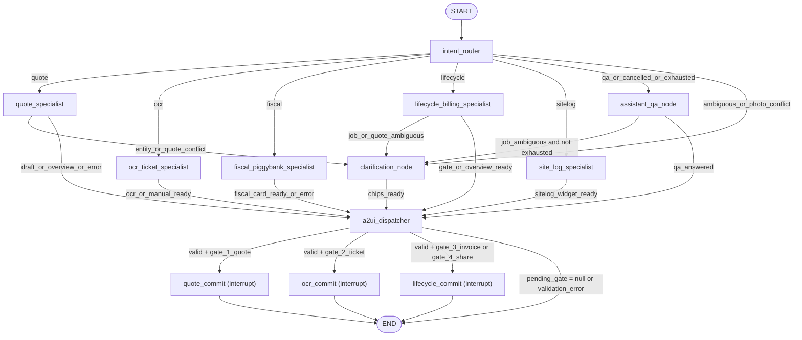

# ObraLocal AI — Diseño del Grafo LangGraph, Estado, Persistencia HITL y Adaptadores Offline

**Versión:** 1.4.0  
**Estado:** Pendiente de verificación final EGM (`egm-design` Ronda 5) y aprobación del usuario  
**Documentos ancla:** [00_CONCEPT_BRIEF.md](file:///c:/Users/Facu/Desktop/AutonomosApp/docs/00_CONCEPT_BRIEF.md) · [01_PRD_AGENTICO_Y_HITL.md](file:///c:/Users/Facu/Desktop/AutonomosApp/docs/01_PRD_AGENTICO_Y_HITL.md)

---

## 1. Arquitectura Modular Desacoplada y Puertos Inyectables (`src/core` · `src/agent` · `src/features`)

El motor multi-agente corre localmente sobre **`@langchain/langgraph/web`** (`StateGraph, Annotation, START, END, interrupt, Command, messagesStateReducer, type Messages`), **`@langchain/langgraph-checkpoint`** y **`@langchain/core/singletons`** (`AsyncLocalStorageProviderSingleton.initializeGlobalInstance(new BrowserAsyncLocalStorage())` inicializado en `main.tsx`/Workers para garantizar `getStore()` dentro de `interrupt()` en navegador/WebView) en TypeScript estricto (`strict: true`). Para aislar el grafo del medio de almacenamiento, respetar la frontera unidireccional de módulos (`src/core/*` nunca importa `src/agent/*` ni `src/features/*`), permitir ejecución `:memory:` y cargar WASM/PDF bajo demanda, `buildObraLocalGraph(deps)` recibe todas sus dependencias por inyección:

```typescript
export interface SqliteExecutor {
  query<T extends Record<string, unknown>>(sql: string, params?: unknown[]): Promise<T[]>;
  run(sql: string, params?: unknown[]): Promise<{ changes: number; lastInsertRowid?: number }>;
  inTransaction<T>(fn: (tx: Pick<SqliteExecutor, "query" | "run">) => Promise<T>): Promise<T>;
  close(): Promise<void>;
}

export interface LocalFileBridge {
  saveTempMedia(bytes: Uint8Array, ext: "jpg" | "png"): Promise<string>;
  commitMedia(tempUri: string, folder: "tickets" | "sitelogs"): Promise<string | null>;
  rollbackCommittedMedia(committedUri: string, restoreTempUri?: string): Promise<void>;
  deleteCommittedMedia(uri: string | null): Promise<void>;
  resolveDisplayUrl(uri: string | null): Promise<{ url: string; revoke: () => void } | null>;
  savePdf(bytes: Uint8Array, fileName: string): Promise<string>;
  deletePdf(uri: string | null): Promise<void>;
  toShareableNativeUri(uri: string): Promise<string>; // Expone archivo vía FileProvider (Cache/file_paths.xml)
  readAsFile(uri: string, fileName: string, mimeType: string): Promise<File>;
  deleteIfTemp(uri: string | null): Promise<void>;
  sweepOrphanTempFiles(activeInterruptUris: Set<string>, maxAgeMs: number): Promise<number>;
}

export interface MemoryCoordinator {
  registerLlmReleaser(fn: () => Promise<void>): void; // Registrado en bootstrap desde features/llm (0 imports core -> features)
  acquireHeavyTask(task: "ocr" | "pdf" | "llm"): Promise<() => Promise<void>>;
  releaseLlmIfLoaded(): Promise<void>;
}

// --- Puertos de Media, PDF, Semilla e Inferencia (declarados en src/core/ports/ para permitir uso y mocks desde Fase 1) ---
export interface OcrPort {
  extractTicketText(
    imageBuffer: Uint8Array,
    mimeType: "image/jpeg" | "image/png"
  ): Promise<{
    rawText: string;
    parsed: {
      supplierName: string | null;
      supplierNif: string | null;
      issueDateIso: string | null;
      vatRate?: 0 | 4 | 10 | 21 | "mixed";
      baseCents: number | null;
      vatCents: number | null;
      totalCents: number | null;
    };
    confidence: number; // Clamp 0..100
  }>;
}

export interface PdfQuoteDocumentInput {
  kind: "quote";
  quoteCode: string;
  issuedDateIso: string;
  emitter: { name: string; nif: string; fiscalAddress: string; phone: string };
  client: { name: string; nif: string; fiscalAddress: string; phone: string };
  jobTitle: string;
  vatRate: 10 | 21;
  subtotalCents: number;
  vatCents: number;
  totalCents: number;
  notes: string;
  lines: Array<{
    description: string;
    unit: string;
    quantityThousandths: number;
    unitPriceCents: number;
    lineSubtotalCents: number;
  }>;
}

export interface PdfInvoiceDocumentInput {
  kind: "invoice";
  invoiceNumber: string;
  invoiceKind: "advance_40" | "final" | "full";
  issuedAtIso: string;
  dueAtIso: string;
  emitter: { name: string; nif: string; fiscalAddress: string; phone: string };
  client: { name: string; nif: string; fiscalAddress: string; phone: string };
  jobCode: string;
  jobTitle: string;
  quoteCode: string;
  vatRate: 10 | 21;
  baseCents: number;
  vatCents: number;
  totalCents: number;
  advanceDeductedBaseCents: number;
  advanceDeductedVatCents: number;
  notes: string;
}

export type PdfBuildInput = PdfQuoteDocumentInput | PdfInvoiceDocumentInput;

export interface PdfPort {
  buildDocumentPdf(input: PdfBuildInput): Promise<{ pdfBytes: Uint8Array; fileName: string }>;
}

export interface WatermarkPort {
  compressAndStamp(params: {
    imageBytes: Uint8Array;
    mimeType: "image/jpeg" | "image/png";
    stamp: { jobCode: string; clientName: string; timestampIso: string };
  }): Promise<{ jpegBytes: Uint8Array; mimeType: "image/jpeg" }>;
}

export interface SeedGraphFreezerPort {
  /** Fase 2 (fuera de inTransaction): congela thr-seed-01-gate1 y thr-seed-02-gate2 tras el COMMIT de Fase 1 */
  freezeDemoGates(): Promise<void>;
}

export interface LocalInferenceAdapter {
  classifyAndExtract(params: {
    text: string;
    activeJobId: string | null;
    activeQuoteId: string | null;
    pendingDisambiguation: z.infer<typeof PendingDisambiguationSchema> | null;
    catalogCandidates: Array<z.infer<typeof RagSnippetSchema>>;
  }): Promise<{
    intent: z.infer<typeof SpecialistRouteSchema>;
    confidence: number;
    engine_used: "deterministic_rule_engine" | "mediapipe_local_llm" | "mediapipe_fallback_deterministic";
    entities: Record<string, unknown>;
  }>;
}

export interface TraceRecorder {
  recordTrace(trace: {
    trace_id: string;
    parent_trace_id: string | null;
    thread_id: string;
    turn_id: string;
    turn_phase: "complete" | "pre_interrupt" | "post_resume";
    routed_intent: string | null;
    node_sequence: string[];
    inference_engine: "deterministic_rule_engine" | "mediapipe_local_llm" | "mediapipe_fallback_deterministic";
    latency_ms: number;
    rag_snippets: Array<z.infer<typeof RagSnippetSchema>>;
    validated_widget: z.infer<typeof ActiveWidgetEnvelopeSchema> | null;
    hitl_gate_id: z.infer<typeof PendingGateSchema> | null;
    hitl_outcome: "pending" | "approved" | "edited" | "rejected" | null;
    rejection_reason: string | null;
    error_code: z.infer<typeof ErrorCodeSchema> | null;
    cloud_cost_eur: 0;
    created_at_ms: number;
  }): Promise<void>;
}

export interface SeedOverrides {
  traceIdOverride?: string;
  quoteFixtureOverride?: {
    summary_es: string;
    proposed_payload: z.infer<typeof Gate1QuoteDraftPayloadSchema>;
  };
  ocrFixtureOverride?: {
    rawText: string;
    parsed: {
      supplierName: string | null;
      supplierNif: string | null;
      issueDateIso: string | null;
      vatRate?: 0 | 4 | 10 | 21 | "mixed";
      baseCents: number | null;
      vatCents: number | null;
      totalCents: number | null;
    };
    confidence: number;
  };
  recoveredDraftOverride?: {
    pending_gate: "gate_1_quote" | "gate_2_ticket";
    summary_es: string;
    proposed_payload: z.infer<typeof Gate1QuoteDraftPayloadSchema> | z.infer<typeof Gate2TicketDraftPayloadSchema>;
  };
}

export interface GraphDependencies {
  executor: SqliteExecutor;
  fileBridge: LocalFileBridge;
  memoryCoordinator: MemoryCoordinator;
  inference: LocalInferenceAdapter;
  ocrPort: OcrPort;
  pdfPort: PdfPort;
  traceRecorder: TraceRecorder;
}
```

### 1.1 Implementaciones de `SqliteExecutor`, `LocalFileBridge`, `FTS5`, Zona Horaria y CSP WASM

Todos los ejecutores activan obligatoriamente **`PRAGMA foreign_keys = ON;`** al abrir cada conexión (SQLite lo desactiva por defecto) para garantizar `ON DELETE CASCADE` entre `lg_checkpoints` y `lg_checkpoint_writes`.

1. **`NativeCapacitorSqliteExecutor` (`@capacitor-community/sqlite` en iOS/Android):**
   - Ejecuta `PRAGMA journal_mode = WAL; PRAGMA busy_timeout = 5000; PRAGMA foreign_keys = ON;`.
   - Serializa operaciones en cola FIFO única, pasando **`transaction: false`** en `PRAGMA`, `BEGIN IMMEDIATE`, `COMMIT`, `ROLLBACK` (`execute()`) y en todas las sentencias internas.
   - Guardia anti-reentrancia en FIFO: llamar a `executor.query/run` dentro de `inTransaction(fn)` en vez de `tx.query/run` lanza `SQLITE_QUERY_ERROR` inmediatamente.
   - En Android, `LocalFileBridge.toShareableNativeUri()` escribe o copia el PDF a ruta compartible por `FileProvider` (`Directory.Cache` o `Directory.Data` declarada en `file_paths.xml`) para `@capacitor/share`.
2. **`WebWorkerSqliteExecutor` (`@sqlite.org/sqlite-wasm` con VFS `opfs-sahpool`):**
   - Corre **obligatoriamente dentro de un Dedicated Web Worker (`sqlite.worker.ts`)** (prohibición de `createSyncAccessHandle()` en hilo principal).
   - Configura `initialCapacity: 12` manejadores OPFS y reporta error tipado si la navegación privada deshabilita OPFS.
   - Retiene `navigator.locks.request("obralocal_sqlite_lock", { ifAvailable: true }, async (lock) => { ... await sessionLifetimeDeferred.promise; })` **durante toda la vida de la pestaña** (con 3 reintentos de `100 ms` durante recargas rápidas antes de alertar pestaña duplicada).
   - **CSP PWA Offline:** binarios `.wasm`/`.js` servidos en local con `connect-src 'self' blob:` (cero dominios externos, 100 % Zero-Cloud), `script-src 'self' 'wasm-unsafe-eval'`, `worker-src 'self' blob:` e `img-src 'self' blob: data:` (miniaturas locales).
   - **`WebOpfsFileBridge`:** lee/escribe OPFS mediante `FileSystemFileHandle.createSyncAccessHandle()` dentro de Worker (evitando `createWritable()`, ausente en Safari iOS `< 26`).
3. **`InMemorySqliteExecutor` (Evals In-App) y `NodeBetterSqliteExecutor` (Vitest):**
   - `EvalRunner` usa `new sqlite3.oo1.DB(":memory:")` (`PRAGMA foreign_keys = ON`) dentro de un **Web Worker efímero** terminado al cerrar Inspector/Diagnóstico.
   - `Vitest` en Node usa `NodeBetterSqliteExecutor` (`better-sqlite3` `:memory:` + `PRAGMA foreign_keys = ON`, normalizando `undefined -> null` e implementando la **misma guardia `isInTx`** anti-reentrancia que `NativeCapacitorSqliteExecutor` para detectar errores FIFO en CI) y dobles `LocalFileBridgeMemory` / `MemoryCoordinatorNoop`.
4. **`FTS5`, Vencimientos Dinámicos en Hora Local y Perfil Emisor (`app_settings`):**
   - Virtuales `FTS5` con `tokenize='unicode61 remove_diacritics 2'` y `sanitizeFts5Query(raw)` reemplazando `-`, `/`, `%`, `"`, `*`, `(`, `)` por espacios y eliminando operadores booleanos independientes (`AND`, `OR`, `NOT`, `NEAR`) antes de entrecomillar cada término restante bajo `AND` implícito.
   - El cálculo de fecha actual `getLocalTodayIso()` usa estrictamente la **fecha local del dispositivo** (`new Date().getFullYear()/getMonth()/getDate()`, jamás UTC `.toISOString().slice(0, 10)`) para evitar falsos no-vencimientos en España entre `00:00` y `01:59` (`UTC+1`/`UTC+2`). `InvoiceRepository` / `BillingService` sincronizan `pendiente_cobro -> vencido` (`due_at_iso < localTodayIso`) antes de toda lectura en especialistas o UI.
   - **Nota de extensión fiscal RD 1619/2012 (`emitter_name`, `emitter_nif`, `emitter_fiscal_address`):** la tabla única `app_settings` almacena el perfil fiscal completo del emisor (pre-cargado en Dataset Demo y editable en Ajustes; en modo *"Empezar de cero"* puede estar inicialmente vacío y completarse inline en Gate 3), además de `last_active_thread_id` y `pending_camera_context_json`. Cada fila en `invoices` guarda instantánea inmutable (`emitter_name_snapshot`, `emitter_nif_snapshot`, `emitter_address_snapshot`) para preservar PDFs históricos ante cambios futuros en Ajustes.

### 1.2 Límites Explícitos: Acciones Directas `src/core/` vs `StateGraph` (`src/agent/`)

| Ruta de Interacción en UI | Motor Ejecutor | Motivo Arquitectónico |
|---|---|---|
| Abrir pestaña **Hucha Fiscal**, cambiar trimestre, marcar factura `pagado`, cambiar `job_status`, pulsar **"Foto Diario"** en barra inferior (`SiteLogStampWidget`), guardar en `site_logs`, CRUD Directorio, Ajustes emisor, Inspector y Evals | **`src/core/` directamente** | Respuesta inmediata sin overhead de grafo y operativa paralela incluso si hay hilos de chat en `INTERRUPTED`. |
| Chat voz/texto, consultas multi-turno (`assistant_qa_node`), creación/edición de presupuesto (Gate 1), escaneo OCR / alta asistida ticket (Gate 2), emisión `FAC` / anticipo `40 %` desde chat/tarjetas (Gate 3), envío externo WhatsApp/Share desde chat/tarjetas (Gate 4), o diario desde chat | **`StateGraph` (`src/agent/`)** | Requiere enrutamiento híbrido, RAG `FTS5`, desambiguación dialogada o pausa HITL con `interrupt()`. |

---

## 2. Contrato del Estado Tipado (`ObraLocalGraphState`), Draft Schemas vs Commit Schemas

*Nota de refinamiento sobre `01_PRD`:* el canal lógico `human_decision` descrito en `01_PRD` se materializa en ejecución como el **valor de retorno tipado de `interrupt(payload)`** (`Command({ resume })`) en lugar de duplicarse como canal en `ObraLocalAnnotation`, evitando redundancia dentro de los checkpoints SQLite. Asimismo, se separan explícitamente **Draft Schemas** (para `ActiveWidgetEnvelopeSchema` e `InterruptPayload.proposed_payload`, soportando `start_empty_quote`, partidas sin precio catalogado `0 €`, OCR manual/fallido y Gate 3/4 con NIF/dirección/teléfono pendientes de completar) de **Commit Schemas** (estrictos, exigidos en cliente antes de `Command({ resume })` y validados dentro de `*_commit`). La UI habilita `action: "approve"` únicamente cuando `proposed_payload` ya satisface el Commit Schema; en caso contrario exige completar campos vía `action: "edit"`.

```typescript
import {
  Annotation,
  messagesStateReducer,
  type Messages,
} from "@langchain/langgraph/web";
import type { BaseMessage } from "@langchain/core/messages";
import { z } from "zod";

// --- Enumeraciones cerradas alineadas con 01_PRD ---
export const JobStatusSchema = z.enum(["pendiente", "en_curso", "finalizado", "cancelado"]);
export const QuoteStatusSchema = z.enum(["borrador", "enviado", "aceptado", "rechazado"]);
export const InvoiceStatusSchema = z.enum(["pendiente_cobro", "pagado", "vencido"]);
export const BillingSubIntentSchema = z.enum(["advance_40", "final_invoice", "share", "overview"]);
export const SiteLogCategorySchema = z.enum(["antes", "despues", "nota"]);
export const CatalogCategorySchema = z.enum(["Fontanería", "Electricidad", "Albañilería", "Pintura", "General"]);
export const QuoteVatRateSchema = z.union([z.literal(10), z.literal(21)]);
export const TicketVatRateSchema = z.union([z.literal(0), z.literal(4), z.literal(10), z.literal(21), z.literal("mixed")]);

export const UiWidgetTypeSchema = z.enum([
  "QuoteBuilderWidget",
  "FiscalPiggyBankWidget",
  "TicketOcrValidatorWidget",
  "JobLifecycleActionWidget",
  "SiteLogStampWidget",
]);

export const PendingGateSchema = z.enum([
  "gate_1_quote",
  "gate_2_ticket",
  "gate_3_invoice",
  "gate_4_share",
]);

export const ActionTypeSchema = z.enum([
  "free_text_or_voice",
  "scan_ticket",
  "manual_ticket_entry",
  "start_empty_quote",
  "start_job_quote",
  "request_invoice_gate",
  "request_advance_gate",
  "request_share_gate",
  "open_job_overview",
  "open_fiscal_piggybank",
  "resolve_disambiguation",
]);

export const ErrorCodeSchema = z.enum([
  "OCR_ENGINE_ERROR",
  "PDF_BUILD_ERROR",
  "SQLITE_QUERY_ERROR",
  "SCHEMA_VALIDATION_ERROR",
  "INVALID_STATE_TRANSITION",
  "LAZY_CHUNK_LOAD_ERROR",
  "STORAGE_QUOTA_EXCEEDED",
]);

export const SpecialistRouteSchema = z.enum([
  "quote_specialist",
  "ocr_ticket_specialist",
  "fiscal_piggybank_specialist",
  "lifecycle_billing_specialist",
  "site_log_specialist",
  "assistant_qa_node",
  "clarification_node",
]);

export const DisambiguationChoiceSchema = z.enum([
  "edit_existing_quote",
  "create_annex_job",
  "open_job_overview",
  "scan_ticket",
  "site_log",
]);

// --- Validadores deterministas ---
export function isValidIsoDate(iso: string): boolean {
  if (!/^\d{4}-\d{2}-\d{2}$/.test(iso)) return false;
  const [y, m, d] = iso.split("-").map(Number);
  const dt = new Date(Date.UTC(y, m - 1, d));
  return dt.getUTCFullYear() === y && dt.getUTCMonth() === m - 1 && dt.getUTCDate() === d;
}

export function deriveFiscalQuarter(iso: string): string {
  const [y, m] = iso.split("-").map(Number);
  return `${y}-T${Math.floor((m - 1) / 3) + 1}`;
}

export function normalizePhoneInput(raw: string): string {
  const cleaned = raw.replace(/[\s\-().]/g, "");
  return /^[6789]\d{8}$/.test(cleaned) ? `+34${cleaned}` : cleaned;
}

export const SpanishTaxIdSchema = z
  .string()
  .trim()
  .toUpperCase()
  .refine((val) => validateSpanishTaxId(val), "NIF/NIE/CIF inválido según dígito de control");

export const E164PhoneSchema = z
  .string()
  .transform(normalizePhoneInput)
  .pipe(z.string().regex(/^\+?[1-9]\d{8,14}$/, "Teléfono inválido para WhatsApp/envío"));

export const ResolvedTargetSchema = z.object({
  client_id: z.string().min(1).optional(),
  job_id: z.string().min(1).optional(),
  quote_id: z.string().min(1).optional(),
  catalog_item_id: z.string().min(1).optional(),
  action_choice: DisambiguationChoiceSchema.optional(),
});

// --- Entrada de Turno y Desambiguación Encadenable ---
export const InputPayloadSchema = z.object({
  client_turn_id: z.string().min(1),
  text: z.string().max(4000).default(""),
  action_type: ActionTypeSchema.default("free_text_or_voice"),
  session_context: z
    .object({
      active_job_id: z.string().min(1).nullable(),
      active_quote_id: z.string().min(1).nullable(),
    })
    .optional(),
  target_ids: z
    .object({
      client_id: z.string().min(1).optional(),
      job_id: z.string().min(1).optional(),
      quote_id: z.string().min(1).optional(),
      invoice_id: z.string().min(1).optional(),
      catalog_item_id: z.string().min(1).optional(),
    })
    .optional(),
  billing_sub_intent: BillingSubIntentSchema.optional(),
  disambiguation_choice: DisambiguationChoiceSchema.optional(),
  quarter: z.string().regex(/^\d{4}-T[1-4]$/).optional(),
  raw_media_uri: z.string().min(1).max(1024).optional(),
  media_kind: z.enum(["ticket_photo", "site_photo", "voice_transcript"]).optional(),
});

export const DisambiguationCandidateSchema = z.object({
  entity_type: z.enum(["job", "client", "quote", "catalog_item", "intent_action"]),
  id: z.string().min(1),
  label: z.string().min(1).max(160),
  subtitle: z.string().max(200).optional(),
  job_id: z.string().min(1).optional(),
  quote_id: z.string().min(1).optional(),
  client_id: z.string().min(1).optional(),
  catalog_item_id: z.string().min(1).optional(),
  action_choice: DisambiguationChoiceSchema.optional(),
});

export const PendingDisambiguationSchema = z.object({
  original_intent: SpecialistRouteSchema.nullable(),
  original_text: z.string().max(4000),
  raw_media_uri: z.string().max(1024).optional(),
  preserved_target: ResolvedTargetSchema.optional(), // Mantiene elecciones previas en desambiguaciones encadenadas
  prompt: z.string().min(1).max(400),
  candidates: z.array(DisambiguationCandidateSchema).min(0).max(5),
  attempts: z.number().int().min(0).max(2).default(0),
});

export const RagSnippetSchema = z.object({
  source_table: z.enum(["catalog_items", "clients", "jobs"]),
  record_id: z.string().min(1),
  title: z.string().min(1).max(160),
  snippet_text: z.string().max(240),
  bm25_score: z.number(),
  metadata: z.record(z.string(), z.union([z.string(), z.number(), z.boolean(), z.null()])).optional(),
});

export const QuickActionSchema = z.object({
  id: z.string().min(1),
  label: z.string().min(1).max(80),
  action_type: ActionTypeSchema,
  payload: InputPayloadSchema.omit({ client_turn_id: true }).partial().optional(),
});

// --- DRAFT SCHEMAS (Widget y proposed_payload) ---
export const Gate1QuoteLineDraftSchema = z.object({
  catalog_item_id: z.string().min(1).nullable(),
  description: z.string().max(240),
  category: CatalogCategorySchema.default("General"),
  unit: z.string().min(1).max(24).default("ud"),
  quantity_thousandths: z.number().int().nonnegative().max(10_000_000),
  unit_price_cents: z.number().int().nonnegative().max(100_000_000),
  original_unit_price_cents: z.number().int().nonnegative().max(100_000_000),
  save_to_catalog: z.boolean().default(false),
});

export const Gate1QuoteDraftPayloadSchema = z.object({
  quote_id: z.string().min(1).nullable(),
  client_id: z.string().min(1).nullable(),
  new_client: z
    .object({
      name: z.string().max(160),
      phone: z.string().max(32).optional(),
      nif: z.string().max(24).optional(),
      fiscal_address: z.string().max(240).optional(),
    })
    .optional(),
  job_id: z.string().min(1).nullable(),
  job_title: z.string().max(180),
  vat_rate: QuoteVatRateSchema,
  notes: z.string().max(1000).default(""),
  lines: z.array(Gate1QuoteLineDraftSchema).min(0),
});

export const Gate2TicketDraftPayloadSchema = z.object({
  supplier_name: z.string().max(160).default(""),
  supplier_nif: z.string().max(24).default(""),
  issue_date_iso: z.string().refine(isValidIsoDate, "Fecha ISO inválida"),
  quarter: z.string().regex(/^\d{4}-T[1-4]$/),
  base_cents: z.number().int().nonnegative().max(100_000_000),
  vat_rate: TicketVatRateSchema.optional(),
  vat_cents: z.number().int().nonnegative().max(100_000_000),
  total_cents: z.number().int().nonnegative().max(100_000_000),
  ocr_confidence: z.number().min(0).max(100).default(0),
  job_id: z.string().min(1).nullable(),
  category: z.string().min(1).max(64).default("materiales"),
  media_uri: z.string().min(1).max(1024).nullable(),
});

export const Gate3InvoiceDraftPayloadSchema = z.object({
  sub_intent: z.enum(["advance_40", "final_invoice"]),
  quote_id: z.string().min(1),
  job_id: z.string().min(1),
  issued_at_iso: z.string().refine(isValidIsoDate, "Fecha de emisión inválida"),
  due_at_iso: z.string().refine(isValidIsoDate, "Fecha de vencimiento inválida"),
  emitter_name: z.string().max(160).default(""),
  emitter_nif: z.string().max(24).default(""),
  emitter_fiscal_address: z.string().max(240).default(""),
  client_id: z.string().min(1),
  client_nif: z.string().max(24).default(""),
  client_fiscal_address: z.string().max(240).default(""),
  notes: z.string().max(1000).default(""),
});

export const Gate4ShareDraftPayloadSchema = z.object({
  document_kind: z.enum(["quote", "invoice"]),
  document_id: z.string().min(1),
  channel: z.enum(["whatsapp", "share_sheet"]),
  recipient_phone: z.string().max(32).default(""),
  message_text: z.string().max(2000),
});

// --- COMMIT SCHEMAS ESTRICTOS (Validación Cliente pre-resume y *_commit post-interrupt) ---
export const Gate1QuoteLineCommitSchema = Gate1QuoteLineDraftSchema.extend({
  description: z.string().min(1).max(240),
  quantity_thousandths: z.number().int().positive().max(10_000_000),
  unit_price_cents: z.number().int().positive().max(100_000_000),
});

export const Gate1QuoteCommitPayloadSchema = Gate1QuoteDraftPayloadSchema.extend({
  job_title: z.string().min(1).max(180),
  new_client: z
    .object({
      name: z.string().min(1).max(160),
      phone: z.string().max(32).optional(),
      nif: z.union([z.literal(""), SpanishTaxIdSchema]).optional(),
      fiscal_address: z.string().max(240).optional(),
    })
    .optional(),
  lines: z.array(Gate1QuoteLineCommitSchema).min(1),
}).refine((p) => (p.client_id !== null) !== (p.new_client !== undefined), {
  message: "Debe indicar exactamente client_id existente o new_client (XOR)",
});

export const Gate2TicketCommitPayloadSchema = Gate2TicketDraftPayloadSchema.extend({
  supplier_name: z.string().min(1).max(160),
  supplier_nif: z.union([z.literal(""), SpanishTaxIdSchema]).default(""),
  total_cents: z.number().int().positive().max(100_000_000),
}).superRefine((t, ctx) => {
  if (t.quarter !== deriveFiscalQuarter(t.issue_date_iso)) {
    ctx.addIssue({ code: z.ZodIssueCode.custom, message: "Trimestre incoherente con issue_date_iso" });
  }
  if (Math.abs(t.base_cents + t.vat_cents - t.total_cents) > 2) {
    ctx.addIssue({ code: z.ZodIssueCode.custom, message: "Descuadre base + IVA vs total > 2 céntimos" });
  }
});

export const Gate3InvoiceCommitPayloadSchema = Gate3InvoiceDraftPayloadSchema.extend({
  emitter_name: z.string().trim().min(1).max(160),
  emitter_nif: SpanishTaxIdSchema,
  emitter_fiscal_address: z.string().trim().min(5).max(240),
  client_nif: SpanishTaxIdSchema,
  client_fiscal_address: z.string().min(5).max(240),
}).refine((inv) => inv.due_at_iso >= inv.issued_at_iso, {
  message: "due_at_iso no puede ser anterior a issued_at_iso",
});

export const Gate4ShareCommitPayloadSchema = Gate4ShareDraftPayloadSchema.extend({
  recipient_phone: z.union([z.literal(""), E164PhoneSchema]).default(""),
  message_text: z.string().min(1).max(2000),
}).refine((s) => s.channel !== "whatsapp" || s.recipient_phone.length > 0, {
  message: "El canal WhatsApp exige teléfono destino válido",
});

// --- Envelope de Widgets A2UI (Draft Schemas para visualización segura) ---
export const ActiveWidgetEnvelopeSchema = z.discriminatedUnion("ui_widget_type", [
  z.object({
    ui_widget_type: z.literal("QuoteBuilderWidget"),
    widget_payload: Gate1QuoteDraftPayloadSchema.extend({
      subtotal_cents: z.number().int().nonnegative(),
      vat_cents: z.number().int().nonnegative(),
      total_cents: z.number().int().nonnegative(),
    }),
  }),
  z.object({
    ui_widget_type: z.literal("TicketOcrValidatorWidget"),
    widget_payload: Gate2TicketDraftPayloadSchema.extend({
      ocr_fallback_reason: ErrorCodeSchema.nullable(),
    }),
  }),
  z.object({
    ui_widget_type: z.literal("FiscalPiggyBankWidget"),
    widget_payload: z.object({
      quarter: z.string().regex(/^\d{4}-T[1-4]$/),
      cobrado_mismo_trimestre_cents: z.number().int().nonnegative(),
      cobros_trimestres_anteriores_cents: z.number().int().nonnegative(),
      pendiente_cobro_trimestre_cents: z.number().int().nonnegative(),
      pendiente_cobro_anteriores_cents: z.number().int().nonnegative(),
      iva_repercutido_cents: z.number().int().nonnegative(),
      iva_soportado_cents: z.number().int().nonnegative(),
      iva_to_reserve_cents: z.number().int().nonnegative(),
      iva_to_compensate_cents: z.number().int().nonnegative(),
      irpf_20_cents: z.number().int().nonnegative(),
      untouchable_tax_cents: z.number().int().nonnegative(),
      available_cash_cents: z.number().int(),
      selected_job_profit_cents: z.number().int().nullable(),
      job_profits: z.array(
        z.object({
          job_id: z.string().min(1),
          job_code: z.string().min(1),
          job_title: z.string().min(1),
          net_profit_cents: z.number().int(),
        })
      ),
    }),
  }),
  z.object({
    ui_widget_type: z.literal("JobLifecycleActionWidget"),
    widget_payload: z.object({
      job_id: z.string().min(1),
      quote_id: z.string().min(1).nullable(),
      invoice_id: z.string().min(1).nullable(),
      mode: z.enum(["overview", "preview_gate_3", "preview_gate_4", "ready_to_share"]),
      pdf_uri: z.string().nullable(),
      gate_3_draft: Gate3InvoiceDraftPayloadSchema.optional(),
      gate_4_draft: Gate4ShareDraftPayloadSchema.optional(),
    }),
  }),
  z.object({
    ui_widget_type: z.literal("SiteLogStampWidget"),
    widget_payload: z.object({
      candidate_job_id: z.string().min(1).nullable(),
      category: SiteLogCategorySchema,
      note_text: z.string().max(1000),
      raw_media_uri: z.string().nullable(),
      stamp_preview_meta: z.object({
        job_code: z.string().nullable(),
        client_name: z.string().nullable(),
        timestamp_iso: z.string(),
      }),
    }),
  }),
]);

// --- Decisión Humana Tipada en Command({ resume }) (estricta en approve/edit/reject) ---
export const HumanDecisionSchema = z
  .discriminatedUnion("gate_id", [
    z.object({
      gate_id: z.literal("gate_1_quote"),
      action: z.enum(["approve", "edit", "reject"]),
      edited_payload: Gate1QuoteCommitPayloadSchema.optional(),
      rejection_reason: z.string().max(300).optional(),
      client_validated_at_ms: z.number().int().nonnegative(),
    }),
    z.object({
      gate_id: z.literal("gate_2_ticket"),
      action: z.enum(["approve", "edit", "reject"]),
      edited_payload: Gate2TicketCommitPayloadSchema.optional(),
      rejection_reason: z.string().max(300).optional(),
      client_validated_at_ms: z.number().int().nonnegative(),
    }),
    z.object({
      gate_id: z.literal("gate_3_invoice"),
      action: z.enum(["approve", "edit", "reject"]),
      edited_payload: Gate3InvoiceCommitPayloadSchema.optional(),
      rejection_reason: z.string().max(300).optional(),
      client_validated_at_ms: z.number().int().nonnegative(),
    }),
    z.object({
      gate_id: z.literal("gate_4_share"),
      action: z.enum(["approve", "edit", "reject"]),
      edited_payload: Gate4ShareCommitPayloadSchema.optional(),
      rejection_reason: z.string().max(300).optional(),
      client_validated_at_ms: z.number().int().nonnegative(),
    }),
  ])
  .superRefine((d, ctx) => {
    if (d.action === "edit" && d.edited_payload === undefined) {
      ctx.addIssue({ code: z.ZodIssueCode.custom, message: "edited_payload obligatorio en action === 'edit'" });
    }
    if ((d.action === "approve" || d.action === "reject") && d.edited_payload !== undefined) {
      ctx.addIssue({
        code: z.ZodIssueCode.custom,
        message: "edited_payload prohibido cuando action es 'approve' o 'reject'",
      });
    }
  });

export const TraceStateSchema = z.object({
  turn_id: z.string(),
  trace_id: z.string(),
  parent_trace_id: z.string().nullable(),
  started_at_ms: z.number().int().nonnegative(),
  node_sequence: z.array(z.string()),
  inference_engine: z.enum([
    "deterministic_rule_engine",
    "mediapipe_local_llm",
    "mediapipe_fallback_deterministic",
  ]),
  rag_hit_count: z.number().int().nonnegative(),
  error_code: ErrorCodeSchema.nullable(),
  rejection_reason: z.string().max(300).nullable(),
  cloud_cost_eur: z.literal(0),
});

// --- Reductores Seguros y Annotation.Root ---
const MAX_CHECKPOINT_MESSAGES = 20;

function boundedMessagesReducer(left: BaseMessage[] | undefined, right: Messages): BaseMessage[] {
  const merged = messagesStateReducer(left ?? [], right);
  return merged.length > MAX_CHECKPOINT_MESSAGES
    ? merged.slice(merged.length - MAX_CHECKPOINT_MESSAGES)
    : merged;
}

function turnTraceReducer(
  prev: z.infer<typeof TraceStateSchema>,
  next: Partial<z.infer<typeof TraceStateSchema>> & { append_node?: string }
): z.infer<typeof TraceStateSchema> {
  const { append_node, ...rest } = next;
  if (rest.turn_id && rest.turn_id !== prev.turn_id) {
    return {
      turn_id: rest.turn_id,
      trace_id: rest.trace_id ?? rest.turn_id,
      parent_trace_id: rest.parent_trace_id ?? null,
      started_at_ms: rest.started_at_ms ?? Date.now(),
      node_sequence: append_node ? [append_node] : rest.node_sequence ?? [],
      inference_engine: rest.inference_engine ?? "deterministic_rule_engine",
      rag_hit_count: rest.rag_hit_count ?? 0,
      error_code: rest.error_code ?? null,
      rejection_reason: rest.rejection_reason ?? null,
      cloud_cost_eur: 0,
    };
  }
  const appended = append_node ? [append_node] : [];
  return {
    ...prev,
    ...rest,
    node_sequence: [...prev.node_sequence, ...appended],
    cloud_cost_eur: 0,
  };
}

export const ObraLocalAnnotation = Annotation.Root({
  messages: Annotation<BaseMessage[], Messages>({
    reducer: boundedMessagesReducer,
    default: () => [],
  }),
  active_job_id: Annotation<string | null>({ reducer: (_p, n) => n, default: () => null }),
  active_quote_id: Annotation<string | null>({ reducer: (_p, n) => n, default: () => null }),
  pending_disambiguation: Annotation<z.infer<typeof PendingDisambiguationSchema> | null>({
    reducer: (_p, n) => n,
    default: () => null,
  }),
  disambiguation_exhausted: Annotation<boolean>({
    reducer: (_p, n) => n,
    default: () => false,
  }),
  input_payload: Annotation<z.infer<typeof InputPayloadSchema> | null>({
    reducer: (_p, n) => n,
    default: () => null,
  }),
  routed_intent: Annotation<z.infer<typeof SpecialistRouteSchema> | null>({
    reducer: (_p, n) => n,
    default: () => null,
  }),
  extracted_entities: Annotation<Record<string, unknown> | null>({
    reducer: (_p, n) => n,
    default: () => null,
  }),
  rag_snippets: Annotation<Array<z.infer<typeof RagSnippetSchema>>>({
    reducer: (_p, n) => n.slice(0, 5),
    default: () => [],
  }),
  active_widget: Annotation<z.infer<typeof ActiveWidgetEnvelopeSchema> | null>({
    reducer: (_p, n) => n,
    default: () => null,
  }),
  quick_actions: Annotation<Array<z.infer<typeof QuickActionSchema>> | null>({
    reducer: (_p, n) => n,
    default: () => null,
  }),
  pending_gate: Annotation<z.infer<typeof PendingGateSchema> | null>({
    reducer: (_p, n) => n,
    default: () => null,
  }),
  turn_trace: Annotation<
    z.infer<typeof TraceStateSchema>,
    Partial<z.infer<typeof TraceStateSchema>> & { append_node?: string }
  >({
    reducer: turnTraceReducer,
    default: () => ({
      turn_id: "",
      trace_id: "",
      parent_trace_id: null,
      started_at_ms: 0,
      node_sequence: [],
      inference_engine: "deterministic_rule_engine",
      rag_hit_count: 0,
      error_code: null,
      rejection_reason: null,
      cloud_cost_eur: 0,
    }),
  }),
});

export type ObraLocalGraphState = typeof ObraLocalAnnotation.State;
```

---

## 3. Topología del Grafo (`StateGraph`), Error Boundaries y Los 12 Nodos



### 3.1 Aciclicidad, Validación Invariante en Capa 3 y Error Boundaries (Capas 1 y 4)

- **DAG Estricto:** `START -> Capa 0 -> Capa 1 -> Capa 2 -> Capa 3 -> Capa 4 | END` (cota **<= 5 supersteps**, cero bucles).
- **Invariante Estricto Capa 3 -> Capa 4 en `a2ui_dispatcher`:** antes de despachar a Capa 4, `a2ui_dispatcher` valida no solo `ActiveWidgetEnvelopeSchema.safeParse()`, sino también correspondencia exacta de puerta (`validateGateWidgetMatch`):
  - `gate_1_quote` <-> `QuoteBuilderWidget`
  - `gate_2_ticket` <-> `TicketOcrValidatorWidget`
  - `gate_3_invoice` <-> `JobLifecycleActionWidget` con `mode === "preview_gate_3"` y `gate_3_draft !== undefined`
  - `gate_4_share` <-> `JobLifecycleActionWidget` con `mode === "preview_gate_4"` y `gate_4_draft !== undefined`
  - Si falla cualquier invariante, `a2ui_dispatcher` fija `error_code = "SCHEMA_VALIDATION_ERROR"`, fuerza `active_widget: null, pending_gate: null`, graba traza y sale a `END`, impidiendo que Capa 4 falle construyendo `InterruptPayload`.
- **Error Boundary Capa 1 y Capa 4:**
  - Capa 1 envuelve su lógica en `try/catch` devolviendo `turn_trace.error_code` y `pending_gate: null` hacia `a2ui_dispatcher`.
  - Capa 4 (`quote_commit`, `ocr_commit`, `lifecycle_commit`): construye `payload` tipado (ya validado por Capa 3) y ejecuta **`const raw = interrupt(payload)` en las primeras líneas SIN `try/catch`**. Todo el bloque posterior (`HumanDecisionSchema.parse(raw)` + chequeo `decision.gate_id === expectedGateId` + `Gate*CommitPayloadSchema.parse(...)` + pre-generación PDF + `inTransaction` + `post_resume`) corre dentro de `try/catch`, limpiando en error `pending_gate: null, active_widget: null, quick_actions: null`, grabando `agent_traces` (`post_resume`) y terminando en `END`.

### 3.2 Secuencia Segura PDF + SQLite (Pre-Generación en Memoria Antes de `inTransaction`)

Para garantizar tanto **cero bloqueos sobre SQLite durante el layout `pdfmake`** como **cero correlativos consumidos o documentos legales sin PDF ante `PDF_BUILD_ERROR` / `STORAGE_QUOTA_EXCEEDED`** (`01_PRD` L184, L201, L207, L242):
1. Tras recibir `"approve"`/`"edit"` desde `interrupt()` y validar `Gate*CommitPayloadSchema`:
   - El nodo commit proyecta en memoria el código del documento bajo el mutex de `GraphRunner` (`PRE-YYYY-NNN` nuevo o código `PRE` existente en reedición de borrador; `ANT-YYYY-NNN` o `FAC-YYYY-NNN` en Gate 3) leyendo `sequences` (solo lectura).
   - Adquiere `MemoryCoordinator.acquireHeavyTask("pdf")`, invoca `pdfPort.buildDocumentPdf(input: PdfBuildInput)` para construir `pdfBytes` en memoria y guarda el archivo con `fileBridge.savePdf(pdfBytes, fileName)` obteniendo `pdfUri` (antes de abrir `BEGIN IMMEDIATE`!). Si `PdfPort` o cuota de almacenamiento falla aquí, **no se toca SQLite ni `sequences`** y el Error Boundary sale recuperablemente con `PDF_BUILD_ERROR` / `LAZY_CHUNK_LOAD_ERROR` / `STORAGE_QUOTA_EXCEEDED`.
2. A continuación abre `executor.inTransaction(...)`: re-verifica todas las invariantes vivas y que el siguiente correlativo de `sequences` coincida exactamente con el proyectado; inserta/actualiza filas **guardando `pdf_uri` atómicamente en `quotes` o `invoices`** y avanza `sequences`. Si `inTransaction` lanzara error, el `catch` ejecuta `await fileBridge.deletePdf(pdfUri)` antes de propagar al Error Boundary para no dejar archivos huérfanos.

### 3.3 Contrato Resumido de los 12 Nodos

1. **`intent_router` (Capa 0):** resetea `rag_snippets: []`, `extracted_entities: null`, `active_widget: null`, `quick_actions: null`, `pending_gate: null`, `disambiguation_exhausted: false` e inicia `turn_trace` (`turn_id`). Sincroniza `session_context`, valida en SQLite `active_job_id` / `active_quote_id` (`quote.job_id === active_job_id`) y dispara sincronización de vencimientos (`getLocalTodayIso()`). Aplica Sección 4.
2. **`quote_specialist` (Capa 1):** si `config?.configurable?.seed_override?.quoteFixtureOverride` o `config?.configurable?.seed_override?.recoveredDraftOverride` (`pending_gate === "gate_1_quote"`) están presentes, emite directamente el `QuoteBuilderWidget` y `pending_gate: "gate_1_quote"` sin `FTS5`. En ejecución normal, verifica primero `job.status !== "cancelado"` cuando existe obra objetivo. Si **`action_type === "start_job_quote"`**, inspecciona presupuestos de esa obra: si **no existe ninguno activo o solo hay `'rechazado'`** (obra directa sin presupuesto), abre `QuoteBuilderWidget` vacío vinculado a ese `job_id` y su `client_id` (permitiendo asignar/crear cliente si `job.client_id === null`); si existe `'borrador'`, lo carga directo; si existe `'enviado'` o `'aceptado'`, devuelve `JobLifecycleActionWidget` (`mode: "overview"`, `pending_gate: null`) con acción `"Crear obra anexa"`. En otros flujos (`free_text_or_voice`), si `action_choice` no es `"edit_existing_quote"` ni `"create_annex_job"` y hay presupuesto previo `'borrador'` o `'enviado'`/`'aceptado'`, deriva a `clarification_node`. Ante `>= 2` clientes/conceptos ambiguos en `FTS5`, deriva a `clarification_node` preservando el progreso en `preserved_target`. Pre-marca `save_to_catalog = true` por defecto solo en líneas recién dictadas/añadidas no catalogadas (`catalog_item_id === null`), manteniendo `save_to_catalog = false` al recargar líneas de un `'borrador'` existente en `quote_items` o en conceptos catalogados. Emite `QuoteBuilderWidget` (`Gate1QuoteDraftPayloadSchema`) y `pending_gate: "gate_1_quote"`.
3. **`ocr_ticket_specialist` (Capa 1):** si `config?.configurable?.seed_override?.ocrFixtureOverride` o `config?.configurable?.seed_override?.recoveredDraftOverride` (`pending_gate === "gate_2_ticket"`) están presentes, los aplica **antes** de verificar `effectiveMediaUri != null` (evitando lanzar `OcrPort` WASM en arranque/recuperación). En ejecución normal, invoca `OcrPort` (`MemoryCoordinator.acquireHeavyTask("ocr")` -> `TesseractOcrAdapter`) **siempre que `effectiveMediaUri != null && action_type !== "manual_ticket_entry"`**, liberando en `finally` y propagando `ocr_confidence` (`0..100`). En `manual_ticket_entry` o fallback (`OCR_ENGINE_ERROR` / `LAZY_CHUNK_LOAD_ERROR`), arma `TicketOcrValidatorWidget` (`Gate2TicketDraftPayloadSchema`) y abre `gate_2_ticket`.
4. **`fiscal_piggybank_specialist` (Capa 1):** consulta únicamente `invoices` (con vencimientos actualizados), `expense_tickets` y `jobs` (nunca `quotes`), calcula en `FiscalEngine.computePiggyBank(quarter)` incluyendo `pendiente_cobro_anteriores_cents` y `job_profits`, y emite `FiscalPiggyBankWidget` (`pending_gate: null`).
5. **`lifecycle_billing_specialist` (Capa 1):** resuelve obra/presupuesto/factura (`resolved_target` o `clarification_node`). Si solo llega `job_id` en `request_share_gate` o solicitud de envío en Chat sin documento concreto, selecciona el documento más reciente por prioridad **`FAC > ANT > PRE` no rechazado**. Si emite solo `mode: "overview"` (`pending_gate: null`), actualiza `active_job_id` y `active_quote_id` directamente; si abre `gate_3_invoice` o `gate_4_share`, **no muta** `active_job_id`/`active_quote_id` antes de confirmar en Gate. Para `advance_40`/`final_invoice`, exige presupuesto con `status !== "rechazado"` y `items.length >= 1`, bloquea doble `ANT`, `ANT` tras `FAC`, o doble `FAC` consultando `invoices`; si no es elegible, devuelve `JobLifecycleActionWidget` (`mode: "overview"`, `pending_gate: null`) enlazando el PDF existente. Si es elegible, lee `emitter_name`, `emitter_nif` y `emitter_fiscal_address` desde `app_settings`, precarga `Gate3InvoiceDraftPayloadSchema` y activa `gate_3_invoice`. Para `share`, precarga `Gate4ShareDraftPayloadSchema` y activa `gate_4_share`.
6. **`site_log_specialist` (Capa 1):** vía lenguaje natural o foto desde chat (botón **"Foto Diario"** va directo por `src/core/`). Pre-carga `candidate_job_id`, actualiza `active_job_id = candidate_job_id` cuando se resuelve (`active_quote_id: null` si cambió de obra), clasifica en `"antes" | "despues" | "nota"` y emite `SiteLogStampWidget` (`pending_gate: null`).
7. **`assistant_qa_node` (Capa 1):** responde consultas SQL parametrizadas de solo lectura y confirma cancelaciones (`cancelled_disambiguation`). Si falta `active_job_id` con varias obras y **`disambiguation_exhausted === false`**, deriva a `clarification_node`; si `disambiguation_exhausted === true`, devuelve lista plana sin volver a `clarification_node`.
8. **`clarification_node` (Capa 2):** redacta pregunta breve y convierte `pending_disambiguation.candidates` en chips `quick_actions` (`resolve_disambiguation`), asegurando `active_widget: null, pending_gate: null`.
9. **`a2ui_dispatcher` (Capa 3):** valida `ActiveWidgetEnvelopeSchema` + `validateGateWidgetMatch(state)` (limpiando a `END` ante error `SCHEMA_VALIDATION_ERROR`) y graba fila #1 de `agent_traces` (`pre_interrupt` o `complete`), respetando `config?.configurable?.seed_override?.traceIdOverride` cuando exista en fase de semilla.
10. **`quote_commit` (Capa 4):** `interrupt(payload)` -> valida `HumanDecisionSchema` (`gate_id === "gate_1_quote"`) y `Gate1QuoteCommitPayloadSchema` -> en `"reject"`, devuelve `active_widget: null, quick_actions: null, pending_gate: null` y traza `post_resume` -> en `"approve"`/`"edit"`, proyecta código `PRE` (nuevo en `sequences` o existente en reedición de `borrador`) y ejecuta Sección 3.2 (PDF en memoria + `savePdf` -> `inTransaction`: verifica `job.status !== "cancelado"`, `quote.status === "borrador"` en edición, unicidad de presupuesto activo, y que si `job.client_id !== null` coincida exactamente con el cliente resuelto — `INVALID_STATE_TRANSITION` si difiere —, ejecutando `UPDATE jobs SET client_id = ? WHERE id = ? AND client_id IS NULL` si no tenía cliente; inserta/actualiza `quotes` **con `pdf_uri`**, `quote_items`, `jobs` serie `OBR` en `"pendiente"`; actualiza `catalog_items` y `feedback_corrections` solo donde `save_to_catalog === true`, omitiendo existentes sin cambio de precio y usando `old_unit_price_cents = 0` en altas nuevas). Devuelve `active_job_id`, `active_quote_id`, `pending_gate: null`, **`active_widget: JobLifecycleActionWidget (mode: "overview", pdf_uri)`**, `quick_actions` y graba `post_resume`.
11. **`ocr_commit` (Capa 4):** `interrupt(payload)` -> valida `gate_id === "gate_2_ticket"` y `Gate2TicketCommitPayloadSchema` -> en `"reject"`, `fileBridge.deleteIfTemp(...)`, limpia `active_widget: null, quick_actions: null, pending_gate: null` y graba `post_resume` -> en `"approve"`/`"edit"`, si **`media_uri !== null`** llama `fileBridge.commitMedia(media_uri, "tickets")` (guardando `null` si fue entrada manual o `seed://`), e inserta `expense_tickets` (con `ocr_confidence`) en `inTransaction` (revirtiendo archivo con `rollbackCommittedMedia` si falla SQLite). Si `job_id !== null && job_id !== state.active_job_id`, actualiza `active_job_id` y limpia **`active_quote_id: null`**; si `job_id === null` (*"Gasto general"*), conserva `active_job_id`/`active_quote_id` previos. Según PRD L204, limpia **`active_widget: null`**, `pending_gate: null`, adjunta resumen + `quick_actions` con **`action_type: "open_fiscal_piggybank"`** y graba `post_resume`.
12. **`lifecycle_commit` (Capa 4):** `interrupt(payload)` -> valida `gate_id` (`gate_3_invoice` | `gate_4_share`) y su `CommitPayloadSchema` -> en `"reject"`, limpia `active_widget: null, quick_actions: null, pending_gate: null` sin consumir `sequences` y graba `post_resume`.
    - En **`gate_3_invoice` (`approve`/`edit`):** proyecta código `ANT`/`FAC` y ejecuta Sección 3.2 (PDF en memoria + `savePdf` -> `inTransaction`: persiste `emitter_name`, `emitter_nif` y `emitter_fiscal_address` en `app_settings` + sus instantáneas inmutables en `invoices`; actualiza `clients.nif`/`fiscal_address`; valida `job.status !== "cancelado"`, `quote.status !== "rechazado"`, ausencia de `FAC` y ausencia de `ANT` si es `advance_40`, y **`issued_at_iso >= MAX(issued_at_iso)`** por serie (`ANT` vs `FAC`); incrementa `sequences`; inserta factura en `"pendiente_cobro"` **con `pdf_uri`**, deduciendo anticipo `40 %` previo en `final_invoice`; promueve `quotes.status = "aceptado"` sin alterar `jobs.status`). Actualiza `active_job_id`, `active_quote_id`, `pending_gate: null`, devuelve **`active_widget: JobLifecycleActionWidget (mode: "overview", invoice_id, pdf_uri)`** y graba `post_resume`.
    - En **`gate_4_share` (`approve`/`edit`):** actualiza `clients.phone` si se editó en `inTransaction`; si `pdf_uri` falta en SQLite, construye `PdfBuildInput` con los datos ya guardados -> `pdfPort.buildDocumentPdf(input)` -> `fileBridge.savePdf` -> `UPDATE quotes/invoices SET pdf_uri = ?` en `inTransaction`; deja **`sent_at` intacto**; promueve `active_job_id`/`active_quote_id`; devuelve **`active_widget: JobLifecycleActionWidget (mode: "ready_to_share", pdf_uri, gate_4_draft: committedPayload)`**, `pending_gate: null` y graba `post_resume`.

---

## 4. Algoritmo de `intent_router` y Desambiguación Encadenable sin Bucles

1. **Prioridad 1 — Desambiguación Activa (`state.pending_disambiguation !== null`):**
   - *(Higiene inmediata de temporales)* Siempre que `pending_disambiguation` se descarte sin reinyectar su foto (acción explícita distinta, nueva foto, cancelación, cambio de tema o `attempts >= 1`), invoca `fileBridge.deleteIfTemp(pending_disambiguation.raw_media_uri ?? null)`.
   - **Acción explícita distinta (`action_type !== "free_text_or_voice" && action_type !== "resolve_disambiguation"`):** descarta `pending_disambiguation = null` y pasa directo a Prioridad 3.
   - **Nueva foto en chat sin tap (`action_type === "free_text_or_voice" && input_payload.raw_media_uri != null`):** limpia foto previa (`deleteIfTemp`), descarta `pending_disambiguation = null` y pasa a Prioridad 2/4.
   - **Cancelación en texto (`"cancelar"`, `"olvídalo"`, `"nada"`):** limpia `pending_disambiguation = null`, marca `extracted_entities = { cancelled_disambiguation: true }` y enruta a `assistant_qa_node`.
   - **Caso A (Tap `resolve_disambiguation`):** fusiona `pending_disambiguation.preserved_target` con los IDs del candidato elegido en `extracted_entities.resolved_target` (`client_id`, `job_id`, `quote_id`, `catalog_item_id`, `action_choice`). Si `action_choice === "create_annex_job"`, `quote_specialist` ignora `state.active_job_id` para crear obra nueva; si `action_choice === "open_job_overview"`, enruta a `lifecycle_billing_specialist` (`overview`). Si `original_intent === null` (Prioridad 2 foto), mapea `"scan_ticket" -> "ocr_ticket_specialist"` y `"site_log" -> "site_log_specialist"`. Restaura `original_text` + `raw_media_uri` y limpia `pending_disambiguation = null`.
   - **Caso B (Voz/texto claro `score >= 0.65`, margen `>= 0.25`):** aplica Caso A.
   - **Caso C (Cambio de tema `confidence >= 0.80`):** descarta `pending_disambiguation = null` y enruta al nuevo intent.
   - **Caso D (`attempts === 0`):** sube `attempts = 1` -> `clarification_node`.
   - **Caso E (`attempts >= 1`):** limpia `pending_disambiguation = null`, activa **`disambiguation_exhausted = true`** -> `assistant_qa_node`.
2. **Prioridad 2 — Foto Directa sin Texto Inequívoco:** crea `pending_disambiguation` (`entity_type: "intent_action"`, `original_intent: null`, `"scan_ticket"` vs `"site_log"`) -> `clarification_node`.
3. **Prioridad 3 — `action_type` Explícito (`!== "free_text_or_voice"`):**
   - `scan_ticket` | `manual_ticket_entry` -> `ocr_ticket_specialist`.
   - `start_empty_quote` | `start_job_quote` -> `quote_specialist`.
   - `request_invoice_gate` | `request_advance_gate` | `request_share_gate` | `open_job_overview` -> `lifecycle_billing_specialist`.
   - `open_fiscal_piggybank` -> `fiscal_piggybank_specialist`.
   - `resolve_disambiguation` huérfano (`pending_disambiguation === null` al pulsar chip antiguo): reconstruye `resolved_target` desde `target_ids`/`disambiguation_choice` validando existencia en SQLite (si existe obra/presupuesto, enruta según `disambiguation_choice` o `open_job_overview`; si ya fue borrado, deriva a `assistant_qa_node` informando que el enlace expiró, nunca al parser libre).
4. **Prioridad 4 — Clasificación Híbrida (`LocalInferenceAdapter`):** `DeterministicSpanishParser` (`< 150 ms`); solo si `confidence < 0.70` y pesos locales activos, consulta `MediaPipeLocalLlmEngine` (`timeout: 3000 ms`, `Zod`) con fallback determinista.

**Regla anti-bucle:** todo especialista prioriza `extracted_entities.resolved_target` antes de `FTS5`, y al emitir una segunda desambiguación encadenada copia `resolved_target` dentro de `pending_disambiguation.preserved_target`.

---

## 5. `interrupt()`, Fórmulas Enteras (`FiscalEngine`) y Gate 4 WebKit vs Nativo

```typescript
export type InterruptPayload =
  | {
      gate_id: "gate_1_quote";
      title: string;
      summary_es: string;
      requires_fiscal_lock: false;
      proposed_payload: z.infer<typeof Gate1QuoteDraftPayloadSchema>;
      ui_widget_type: "QuoteBuilderWidget";
    }
  | {
      gate_id: "gate_2_ticket";
      title: string;
      summary_es: string;
      requires_fiscal_lock: false;
      proposed_payload: z.infer<typeof Gate2TicketDraftPayloadSchema>;
      ui_widget_type: "TicketOcrValidatorWidget";
    }
  | {
      gate_id: "gate_3_invoice";
      title: string;
      summary_es: string;
      requires_fiscal_lock: true;
      proposed_payload: z.infer<typeof Gate3InvoiceDraftPayloadSchema>;
      ui_widget_type: "JobLifecycleActionWidget";
    }
  | {
      gate_id: "gate_4_share";
      title: string;
      summary_es: string;
      requires_fiscal_lock: false;
      proposed_payload: z.infer<typeof Gate4ShareDraftPayloadSchema>;
      ui_widget_type: "JobLifecycleActionWidget";
    };
```

- **Gate 4 (`ready_to_share`) Web PWA vs Nativo Capacitor:**
  - En **Web PWA**, `JobLifecycleActionWidget` conserva `gate_4_draft` validado y `pdf_uri`, precarga `preloadedFile = await fileBridge.readAsFile(...)` en `useEffect` (deshabilitando el botón hasta tener el `File`), y en la primera línea síncrona del `onClick` comprueba `navigator.canShare?.({ files: [preloadedFile] })` -> `navigator.share({ files: [preloadedFile], ... })`. Si `navigator.canShare` no está disponible y hay `recipient_phone`, descarga PDF + abre `https://wa.me/${phoneDigits}?text=...`; si `channel === "share_sheet"` sin `recipient_phone` ni `canShare`, **descarga solo el PDF** con aviso claro (jamás abre `https://wa.me/?text=` vacío).
  - En **Capacitor Nativo**, al entrar en `ready_to_share` se intenta lanzar automáticamente `@capacitor/share` con `files: [await fileBridge.toShareableNativeUri(pdf_uri)]` (exposición válida vía `FileProvider`, nunca un `File` Web) —o deep link `wa.me` tras adjuntar—, manteniendo visible el botón **"Abrir Compartir / WhatsApp"** para reintentos manuales si el usuario cancela el sheet nativo.
  - En ambos entornos, `quotes.sent_at` / `invoices.sent_at` (`borrador -> enviado`) se actualiza en `src/core/` **únicamente** tras confirmación de envío (nunca ante `AbortError`).

```typescript
export function roundHalfUpDiv(numerator: number, denominator: number): number {
  if (denominator <= 0 || !Number.isInteger(numerator) || !Number.isInteger(denominator)) {
    throw new Error("SCHEMA_VALIDATION_ERROR: operandos enteros requeridos");
  }
  const sign = numerator < 0 ? -1 : 1;
  return sign * Math.floor((Math.abs(numerator) * 2 + denominator) / (2 * denominator));
}
// Presupuestos / Anticipo 40 % / Factura Final (céntimos enteros):
// line_base_cents     = roundHalfUpDiv(qty_thousandths * unit_price_cents, 1000)
// vat_cents           = roundHalfUpDiv(base_cents * vat_rate, 100)
// advance_base_cents  = roundHalfUpDiv(quote_base_cents * 40, 100)
// advance_vat_cents   = roundHalfUpDiv(advance_base_cents * vat_rate, 100)
// final_base_cents    = quote_base_cents - advance_base_cents
// final_vat_cents     = quote_vat_cents - advance_vat_cents
//
// Desglose inverso 21 % opcional en TicketOcrValidatorWidget:
// base_cents_inv_21   = roundHalfUpDiv(total_cents * 100, 121)
// vat_cents_inv_21    = total_cents - base_cents_inv_21
//
// Hucha Fiscal Trimestral (invoices + expense_tickets + jobs, nunca quotes):
// iva_repercutido_cents            = sum(invoices.vat_cents emitidas en quarter)
// iva_soportado_cents              = sum(expense_tickets.vat_cents en quarter)
// iva_to_reserve_cents             = Math.max(0, iva_repercutido_cents - iva_soportado_cents)
// iva_to_compensate_cents          = Math.max(0, iva_soportado_cents - iva_repercutido_cents)
// cobrado_mismo_trimestre_cents    = sum(invoices.total_cents emitidas y cobradas en quarter)
// cobros_trimestres_anteriores_c   = sum(invoices.total_cents emitidas en trimestre < quarter y cobradas en quarter)
// pendiente_cobro_trimestre_cents  = sum(invoices.total_cents en quarter con status IN ('pendiente_cobro','vencido'))
// pendiente_cobro_anteriores_cents = sum(invoices.total_cents en trimestre < quarter con status IN ('pendiente_cobro','vencido'))
// irpf_20_cents                    = roundHalfUpDiv(Math.max(0, base_facturada_q - base_gastos_q) * 20, 100)
// untouchable_tax_cents            = iva_to_reserve_cents + irpf_20_cents
// available_cash_cents             = cobrado_mismo_trimestre_cents - total_gastos_q_cents - untouchable_tax_cents
// beneficio_neto_obra_cents(jobId) = sum(invoices.base_cents de jobId) - sum(expense_tickets.base_cents de jobId)
```

---

## 6. Persistencia Real (`CapacitorSqliteSaver`), Migración de Arranque y Recuperación

### 6.1 Esquema y Reglas del Checkpointer (`BaseCheckpointSaver`)

- **`lg_checkpoints`** `(thread_id, checkpoint_ns, checkpoint_id, parent_checkpoint_id, checkpoint_type, checkpoint_data, metadata_type, metadata_data, schema_version, has_pending_interrupt, created_at_ms)` `PRIMARY KEY (thread_id, checkpoint_ns, checkpoint_id)` + índice `(thread_id, checkpoint_ns, checkpoint_id DESC)`.
- **`lg_checkpoint_writes`** `(thread_id, checkpoint_ns, checkpoint_id, task_id, task_path, idx, channel, write_type, write_data)` `PRIMARY KEY (thread_id, checkpoint_ns, checkpoint_id, task_id, idx)` con `FOREIGN KEY ... ON DELETE CASCADE`.

```typescript
const WRITES_IDX_MAP: Record<string, number> = {
  __error__: -1,
  __scheduled__: -2,
  __interrupt__: -3,
  __resume__: -4,
};
```

Reglas deterministas:
1. **`migrateIncompatibleCheckpoints()` único al arrancar (nunca en `getTuple`/`list`):** tras inicializar `SqliteExecutor` y antes de construir `GraphRunner`, inspecciona una sola vez filas con `schema_version !== CHECKPOINT_SCHEMA_VERSION`, rescata de JSON válidos su último `active_widget`/`pending_gate` Gate 1/2 hacia `recovered_drafts` (deduplicado por `thread_id`), elimina de `lg_checkpoints` las filas incompatibles (`ON DELETE CASCADE`) y actualiza `UPDATE chat_threads SET status = 'idle', pending_gate = NULL WHERE thread_id = ?` en esos hilos para no dejar UI colgada en `'interrupted'`. De este modo **`getTuple()` y `list()` son 100 % solo lectura** (`WHERE schema_version = ?`), sin duplicados ni zombis `has_pending_interrupt = 1`.
2. **Ordenación estricta por `checkpoint_id DESC, rowid DESC`:** todas las consultas (`getTuple`, `list` y poda de `put`) ordenan por el UUIDv6 monotónico `checkpoint_id DESC, rowid DESC` (nunca solo `created_at_ms`, inmune a empates en el mismo milisegundo).
3. **`putWrites(config, writes, taskId, taskPath = "")`:** asigna `WRITES_IDX_MAP[channel] ?? idx` (`INSERT OR REPLACE` para `< 0`, `INSERT OR IGNORE` para `>= 0`). Si `writes.some(([ch]) => ch === "__interrupt__")`, ejecuta `UPDATE lg_checkpoints SET has_pending_interrupt = 1 WHERE thread_id = ? AND checkpoint_ns = ? AND checkpoint_id = ?`.
4. **`put(...)`:** dentro de `inTransaction`, limpia `has_pending_interrupt = 0` del `(thread_id, checkpoint_ns)`, inserta el nuevo checkpoint (`has_pending_interrupt = 0`) y ejecuta poda conservando `has_pending_interrupt = 1` y los últimos `RETENTION_PER_THREAD = 50` ordenados por `checkpoint_id DESC, rowid DESC`.
5. **Simetría UTF-8 / Base64 y Delegación a `checkpointsRepo` (`src/core/`):** `dumpsTyped` no JSON se guarda como `b64:` + Base64 y se decodifica simétricamente a `Uint8Array` en `getTuple`/`list` (ordenando writes por `task_path, task_id, idx`). `deleteThread(threadId)` y `purgeAllCheckpoints(tx?)` delegan directamente en `checkpointsRepo` (`src/core/db/repositories/checkpointsRepo.ts`) para respetar la frontera unidireccional (`core` nunca importa `agent`).

### 6.2 Mutex de `GraphRunner`, Polyfill `AsyncLocalStorage`, `reopenRecoveredDraft` y Recuperación por Cámara

- **Serialización Segura para `BrowserAsyncLocalStorage`:** en navegador y Capacitor WebView, `AsyncLocalStorageProviderSingleton.initializeGlobalInstance(new BrowserAsyncLocalStorage())` usa una pila en memoria (`push` en `run()`, `pop` en `finally`). `GraphRunner` serializa toda llamada activa a `compiledGraph.invoke(...)` a través de una cola FIFO de ejecución única (los hilos paralelos mantienen estado independiente en `lg_checkpoints`, pero nunca se solapan en tiempo de ejecución en el mismo bucle de eventos), garantizando que `interrupt()` siempre resuelva `getStore()` sin interferencias.
- **`GraphRunner.resumeGate` y `reopenRecoveredDraft`:** `resumeGate` verifica dentro del mutex que `Boolean(state.tasks?.[0]?.interrupts?.length)` coincida con `expectedGateId` antes de emitir `Command({ resume })`. Ante borradores rescatados en `recovered_drafts` tras migración, `reopenRecoveredDraft(draftId)` abre un hilo nuevo e invoca el grafo con `configurable.seed_override.recoveredDraftOverride` para congelar limpiamente Gate 1/2 y marcar `dismissed = 1` en `inTransaction`. (`DemoSeeder.freezeDemoGates()` envuelve cada `replayInputToFreeze` en el estado inicial tipado `{ input_payload, messages: replayInputToFreeze.text ? [new HumanMessage(replayInputToFreeze.text)] : [], active_job_id: replayInputToFreeze.session_context?.active_job_id ?? null, active_quote_id: replayInputToFreeze.session_context?.active_quote_id ?? null }` y mapea `trace_id` hacia `configurable.seed_override.traceIdOverride`).
- **Recuperación tras cierre del WebView por Cámara (`appRestoredResult`):** antes de abrir `@capacitor/camera`, la UI guarda `pending_camera_context_json` (`source: "chat" | "scan_ticket" | "site_log" | "global_camera"`) y `last_active_thread_id` en `app_settings`; en flujo normal los limpia en `finally`. Si Android/iOS mata el WebView, `main.tsx` captura `appRestoredResult` en una cola idempotente `pendingCameraRestores` consumida por `consumePendingCameraRestores()` al montar `<App />`: `"global_camera"` abre el selector post-captura, `"site_log"` abre `SiteLogStampWidget`, y `"scan_ticket"`/`"chat"` verifican el estado del hilo en SQLite antes de lanzar `scan_ticket`.

---

## 7. Hardware, OCR, PDF.js, Tarifario Dinámico y Reglas UI

- **`VoiceInputAdapter` y permisos nativos:** Web comprueba `SpeechRecognition` / `webkitSpeechRecognition` antes de invocar `getUserMedia`. En Android, [AndroidManifest.xml](file:///c:/Users/Facu/Desktop/AutonomosApp/android/app/src/main/AndroidManifest.xml) declara `MODIFY_AUDIO_SETTINGS`, `RECORD_AUDIO`, `CAMERA` y `<queries>` (`android.speech.RecognitionService`, `android.media.action.IMAGE_CAPTURE`). `CapacitorVoiceInputAdapter` usa exclusivamente `available()`, `checkPermissions()`, `requestPermissions()`, `start({ language: "es-ES", maxResults: 1, partialResults: false, popup: false })`, `isListening()` y `stop()`.
- **`TesseractOcrAdapter` y `pdfjs-dist` (`PDF.js` legacy offline):** `TesseractOcrAdapter` es el **propietario único** del lock `"ocr"` en `MemoryCoordinator` tanto para `extractTicketText` como para `extractRawTextBatch` (sin lock duplicado en `ocrTicketSpecialist.ts`). El importador de documentos ([documentImportPipeline.ts](file:///c:/Users/Facu/Desktop/AutonomosApp/src/features/pricing/documentImportPipeline.ts)) carga `pdfjs-dist/legacy/build/pdf.mjs` con `isEvalSupported: false`, `useWorkerFetch: false` y activos locales en `assets/pdf/` (`worker`, `cmaps`, `standard_fonts`), procesando hasta 15 páginas por PDF y lanzando OCR en lote solo para páginas escaneadas.
- **Tarifario Dinámico y `ClientProfileWidget`:** `app_settings.hourly_rate_cents` define la tarifa base por hora; `catalog_items` añade `pricing_mode` (`fixed` | `hourly_plus_materials`), `estimated_hours_thousandths` y `materials_cents` manteniendo `unit_price_cents` como importe efectivo único. Las modificaciones manuales de precio en presupuestos (`save_to_catalog`) pasan a `fixed`. `ClientProfileWidget` opera como widget Generative UI directo (Draft permisivo en `ActiveWidgetEnvelopeSchema`, validación estricta `ClientProfileCommitSchema` al confirmar), respetando los 4 gates HITL y los 9 triggers FTS5 de [schema.sql](file:///c:/Users/Facu/Desktop/AutonomosApp/docs/schema.sql).
- **`TesseractOcrAdapter` (CSP `connect-src 'self' blob:` estricto + Clamp de Confianza):** calcula base `const ocrBase = new URL("assets/ocr/", new URL(import.meta.env.BASE_URL, window.location.origin)).href;` y llama `createWorker("spa", 1, { workerPath: `${ocrBase}worker.min.js`, corePath: ocrBase, langPath: ocrBase.replace(/\/$/, ""), workerBlobURL: false, gzip: true, cacheMethod: "none" })`. Reescalado `@capacitor/camera` (`1600x1600`, `correctOrientation: true`) + proporcional `Math.max(w, h) <= 1600`, pasa **`Blob`** (`canvas.toBlob(..., "image/jpeg", 0.92)`, compatible con `connect-src 'self' blob:` sin requerir `data:` en `connect-src`) a `worker.recognize()`, aplica clamp **`Math.max(0, Math.min(100, Math.round(rawConfidence || 0)))`**, libera `imageBitmap.close()` y canvas (`width = 0; height = 0`), y cierra con `await ocrWorker.terminate()` en `finally`. `MemoryCoordinator` espera descarga de `MediaPipeLocalLlmEngine` antes de cargar OCR o `pdfmake` y `sweepOrphanTempFiles` purga `tmp/` `> 24 h` al arranque sin tocar checkpoints `has_pending_interrupt = 1`.
- **`agent_traces` (`cloud_cost_eur = 0.00`):** `a2ui_dispatcher` graba fila #1 (`pre_interrupt` o `complete`) con errores de Capa 1 si los hubo; cada `*_commit` abre nuevo `trace_id` ligado por `parent_trace_id`, limpia `error_code: null` y mide `started_at_ms = Date.now()` post-reanudación al grabar fila #2 (`post_resume`).
- **`feedback_corrections` + `FTS5`:** solo con `save_to_catalog === true` (en existentes solo si `unit_price_cents !== original_unit_price_cents`; en altas nuevas `old_unit_price_cents = 0`) muta `catalog_items` y graba diff sincronizado en `catalog_items_fts` mediante triggers de [schema.sql](file:///c:/Users/Facu/Desktop/AutonomosApp/docs/schema.sql) (Documento 03 junto a [03_CONTRATOS_API_Y_SEED.json](file:///c:/Users/Facu/Desktop/AutonomosApp/docs/03_CONTRATOS_API_Y_SEED.json)).
